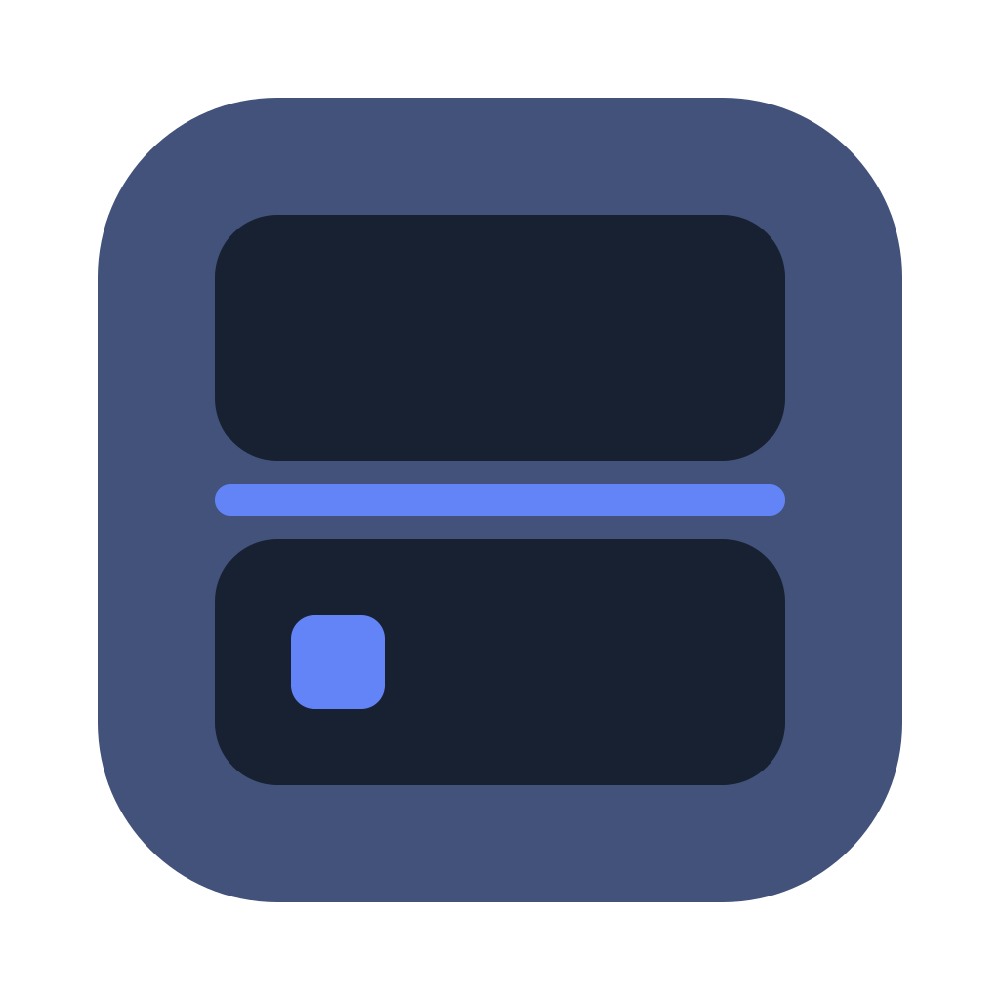
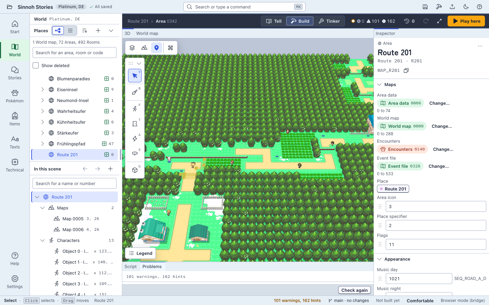
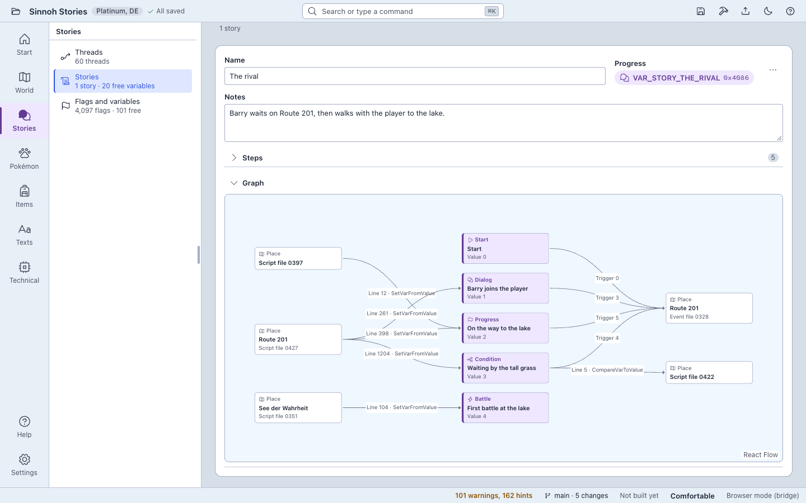
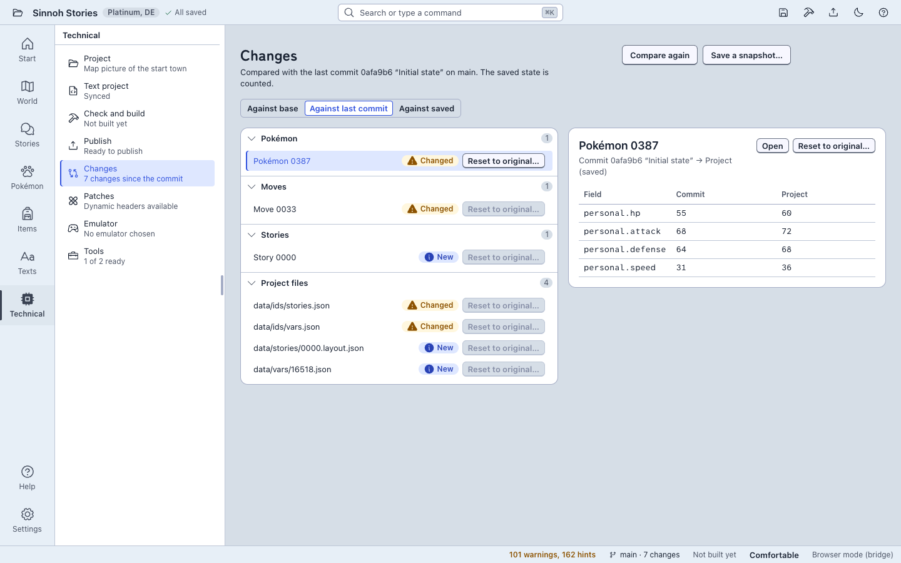

<p align="center">
  
</p>

# Gen4 Studio

[English](README.md) · Deutsch

Gen4 Studio ist ein moderner, plattformübergreifender Editor für ROM-Hacks von Pokémon Platin, HeartGold und SoulSilver. Welten, Geschichten, Scripts und Daten entstehen in einem textbasierten Projekt und werden zu einer ROM oder einem xdelta-Patch gebaut. Arbeitet über MCP mit KI-Agenten zusammen.

[](LICENSE)
[](https://github.com/Kaago/gen4-studio/releases/latest)
[](https://github.com/Kaago/gen4-studio/actions/workflows/ci.yml)

<!-- section: about -->
## Über Gen4 Studio

Gen4 Studio behandelt einen ROM-Hack wie ein Softwareprojekt. Sie öffnen Ihre eigene ROM einmal, und danach besteht der Hack aus einem Ordner voller Dateien: Karten, Scripts, Texte und Spieldaten. Die bearbeiten Sie in der App, von Hand oder mit einem KI-Agenten, verwalten sie in Git und lesen sie als einfachen Text. Zum Schluss baut Gen4 Studio eine ROM oder einen xdelta-Patch, damit Sie Ihre Arbeit teilen können, ohne das Spiel zu teilen.

Gen4 Studio ist für Leute gedacht, die Orte und Geschichten bauen wollen, statt Tabellen zu bearbeiten: Sie arbeiten mit Orten, Figuren, Dialogen, Türen und Trainern, und Gen4 Studio kümmert sich dahinter um Header, Matrizen, Eventdateien und Archive. Die Oberfläche gibt es auf Deutsch und auf Englisch. Sie folgt der Systemsprache und lässt sich in den Einstellungen umschalten.

<!-- section: screenshots -->
## Screenshots



| Erzählen | Technik |
|---|---|
|  |  |

<!-- section: features -->
## Was es kann

- **Welt.** Orte erkunden statt Tabellen: Weltkarte, Gebiete und Räume, in 2D und 3D. Neue Gebiete und Räume legen Assistenten an, dazu bearbeiten Sie Header, Matrizen, Gebäude, Events und Warps und malen neue Karten aus Kacheln mit Höhen, Rampen und Smart Drawing. Gen4 Studio backt sie zu Modell, Terrain und Kollision des Spiels. PNG-Texturen sowie OBJ- und glTF-Modelle lassen sich importieren.
- **Erzählen.** Geschichten als Fäden aus Schritten anlegen, die an Flags und Variablen hängen. Figuren mit Dialog, Türen und Trainer mit Team und Kampftexten platzieren und sehen, wer sonst noch einen bestimmten Satz sagt.
- **Scripts und Texte.** Ereignis-Scripts in der Script-Sprache rotom mit Language Server bearbeiten, Spieltexte mit einer Vorschau des DS-Bildschirms.
- **Daten.** Pokédex-Einträge, Attacken, Lernlisten, Entwicklungen, Ei-Attacken, Items, Trainer und Begegnungen bearbeiten. Löschen ist gesperrt, solange noch etwas darauf verweist, und geänderte Einträge lassen sich auf ihren Originalzustand zurücksetzen.
- **Prüfen.** Dutzende Projektprüfungen über Welt, Scripts, Texte und Daten finden Probleme wie kaputte Verweise, fehlende Nachrichten und zu breiten Text für den DS-Bildschirm, bevor das Spiel sie findet. Jeder Befund nennt den Ausweg, und etliche lassen sich mit Vorschau und einem Undo-Schritt beheben.
- **Bauen.** Eine ROM oder einen xdelta-Patch bauen. Ein unverändertes Projekt baut eine ROM, die byte-gleich zur Ausgangs-ROM ist. „Hier spielen“ baut und startet Ihren Emulator; „Veröffentlichen…“ schreibt einen selbstgeprüften xdelta-Patch mit Version und Änderungsnotizen.
- **Textprojekt mit Git.** Die Spieldaten liegen als JSON-Dateien vor, eine Entität je Datei, sodass Änderungen als lesbare Diffs erscheinen. Gen4 Studio richtet auf Wunsch ein lokales Git-Repository ein und sichert Stände.
- **Agenten.** Ein eingebauter MCP-Server lässt KI-Agenten wie Claude Code das offene Projekt lesen und bearbeiten.
- **DSPRE-Projekte.** Einen vorhandenen DSPRE-Projektordner öffnen und DSPRE neben Gen4 Studio weiter benutzen.

<!-- section: games-platforms -->
## Unterstützte Spiele und Plattformen

| Spiel | Stand |
|---|---|
| Pokémon Platin | Mit einer deutschen ROM geprüft. Andere Regionen laufen über denselben Code, wurden aber nicht ausprobiert. |
| Pokémon HeartGold | Mit deutscher und US-ROM geprüft. Andere Regionen laufen über denselben Code, wurden aber nicht ausprobiert. |
| Pokémon SoulSilver | Gleiche Engine-Familie wie HeartGold, noch kein Testprojekt, nicht ausprobiert. |
| Pokémon Diamant und Perl | Noch nicht freigegeben. Gen4 Studio erkennt diese ROMs, legt aus ihnen aber kein Projekt an, weil es kein Testprojekt gibt. |

| Plattform | Paket | Hinweise |
|---|---|---|
| macOS 13 oder neuer, Apple Silicon (arm64) | DMG | Alles, einschließlich des Spielmodus live. |
| Windows 10 oder neuer, x64 | NSIS-Installer | Alles außer dem Spielmodus live. In der CI gebaut und getestet (stille Installation, `studio doctor`, Rauchtest), noch nicht von Hand auf einem Windows-PC geprüft; die Agenten-Verbindung zur laufenden App ist nicht verifiziert. |

„Hier spielen“ startet auf beiden Plattformen den Emulator Ihrer Wahl; beim ersten Mal fragt Gen4 Studio danach (zum Beispiel melonDS). Der Spielmodus live, der Flags und Variablen im laufenden Spiel liest und setzt, braucht melonDS 1.1 oder neuer und läuft nur unter macOS. Für Linux gibt es keinen Release-Build.

<!-- section: install -->
## Installation

Laden Sie das Paket für Ihr System vom [neuesten Release](https://github.com/Kaago/gen4-studio/releases/latest) herunter:

- macOS: `Gen4-Studio_<Version>_aarch64.dmg`
- Windows: `Gen4-Studio_<Version>_x64-setup.exe`

Die Datei `SHA256SUMS.txt` auf derselben Seite nennt die Prüfsumme jeder Datei.

Die Pakete sind noch nicht mit einem Entwicklerzertifikat signiert (macOS: ad-hoc-Signatur, keine Notarisierung; Windows: unsigniert). Ihr System warnt deshalb beim ersten Start der App.

**macOS (Gatekeeper).** Das DMG öffnen und Gen4 Studio in „Programme“ ziehen. Die App einmal starten; macOS blockiert sie. Dann in den Systemeinstellungen unter „Datenschutz & Sicherheit“ die Meldung zu Gen4 Studio suchen, „Trotzdem öffnen“ wählen und bestätigen. Unter macOS 14 und älter geht auch Rechtsklick auf die App, „Öffnen“ und im Dialog noch einmal „Öffnen“. Oder im Terminal das Quarantäne-Merkmal entfernen:

```sh
xattr -dr com.apple.quarantine "/Applications/Gen4 Studio.app"
```

**Windows (SmartScreen).** Den Installer starten. Zeigt SmartScreen „Der Computer wurde durch Windows geschützt“, wählen Sie „Weitere Informationen“ und dann „Trotzdem ausführen“. Der Installer braucht keine Administratorrechte und installiert nach `%LOCALAPPDATA%\Gen4 Studio`. Fehlt WebView2, lädt der Installer es nach.

<!-- section: quickstart -->
## Schnellstart

Sie brauchen Ihre eigene, rechtmäßig erworbene ROM-Datei (`.nds`) von Platin, HeartGold oder SoulSilver. Gen4 Studio enthält keine ROM-Daten.

1. Wählen Sie auf dem Startbildschirm **Neues Spiel aus ROM…** (oder ziehen Sie die `.nds`-Datei auf das Fenster). Gen4 Studio liest die ROM und sagt Ihnen, ob sie geprüft ist.
2. Wählen Sie eine Vorlage: Original (das Spiel, wie es ist), Leere Region mit Startstadt oder Nur Daten. Geben Sie einen Namen und einen Ordner an und lassen Sie das Projekt anlegen. Dabei wird die ROM in den Projektordner entpackt.
3. Öffnen Sie **Bauen** und legen Sie Ihre erste Route an: Starten Sie den Assistenten für ein neues Gebiet, der vorhandene Karten in ein Gebiet mit eigenem Ortsnamen kopiert. Unter **Erzählen** fügen Sie eine Figur mit Dialog, eine Tür oder einen Trainer hinzu. **Technik** enthält die Prüfungen, die Bauschritte und die Liste der Änderungen gegenüber dem Original.
4. Wählen Sie **Hier spielen**. Gen4 Studio speichert, baut und startet Ihren Emulator mit dem Ergebnis. Beim ersten Mal fragt es, welchen Emulator es nehmen soll.
5. Wählen Sie **Veröffentlichen…**, wenn Sie den Hack teilen möchten. Geben Sie eine Version und Änderungsnotizen an; Gen4 Studio schreibt einen xdelta-Patch gegen Ihre Basis-ROM, prüft, dass er sich anwenden lässt, und hält die Veröffentlichung fest. Teilen Sie den Patch, niemals die ROM.

<!-- section: agents -->
## Agenten (MCP)

Gen4 Studio spricht das Model Context Protocol. Ein Agent wie Claude Code liest und bearbeitet ein Projekt über dieselben Befehle wie die Oberfläche: kuratierte Werkzeuge mit englischen Namen und Schemas, einige Ressourcen (ein Glossar, die MCP-Anleitung und die Formatbeschreibungen) und drei Beispiel-Prompts. Alles läuft auf Ihrem Rechner: kopflos über stdio, in der laufenden App nur über HTTP auf `127.0.0.1`.

In der laufenden App arbeitet der Agent im Projekt, das Sie gerade offen haben, in derselben Sitzung. Seine Schritte stehen im Verlauf und lassen sich wie Ihre eigenen zurücknehmen. Sie behalten die Kontrolle: Der Zugriff ist standardmäßig aus und wird in Einstellungen › Agenten eingeschaltet, Sie erteilen ihn je Projekt („Nicht“, „Lesen“ oder „Lesen und bearbeiten“), die App fragt beim ersten Zugriff und noch einmal vor allem Unumkehrbaren, und „Nur lesen“ und „Trennen“ sind jederzeit erreichbar. So verbinden Sie Claude Code mit der laufenden App:

```sh
# Den Pfad der Programmdatei „studio“ Ihrer Installation verwenden.
claude mcp add gen4-studio -- "/Applications/Gen4 Studio.app/Contents/MacOS/studio" mcp

# Kopflos, ohne App: Der Server öffnet das Projekt selbst.
claude mcp add gen4-studio -- "/Applications/Gen4 Studio.app/Contents/MacOS/studio" mcp --project "<Projektordner>"
```

Die vollständige Anleitung mit Werkzeugen, Freigaben und Grenzen steht in [docs/mcp.md](docs/mcp.md) (Deutsch) und [docs/en/mcp.md](docs/en/mcp.md) (Englisch). Unter Windows ist die Verbindung zur App noch nicht geprüft.

<!-- section: project-format -->
## Projektformat

Ein Gen4-Studio-Projekt ist ein DSPRE-Projektordner (die entpackte ROM) plus eine Textebene. In einem Textprojekt liegen die Spieldaten zusätzlich als kanonisches JSON unter `data/`, eine Entität je Datei mit stabilen IDs, beschrieben durch `g4-project.json`; Texte und Scripts bleiben in `expanded/`, die Scripts sind rotom-Quellen. So lässt sich ein Projekt gut prüfen, von Hand bearbeiten und in Git halten: Gen4 Studio kann `.gitignore` und `.gitattributes` einrichten und Stand-Commits anlegen, nur in einem lokalen Repository, nie mit Remote und nie mit Push. Textprojekte gibt es für Platin, HeartGold und SoulSilver. Ein Projekt enthält Daten aus dem Spiel; halten Sie es aus öffentlichen Repositories heraus und teilen Sie stattdessen einen Patch. Das Format ist in [docs/formats/text_project.md](docs/formats/text_project.md) beschrieben (auf Deutsch, mit englischem Kopfabsatz).

<!-- section: dspre -->
## Verhältnis zu DSPRE

**Verhältnis zu DSPRE.** Gen4 Studio gäbe es ohne [DSPRE](https://github.com/DS-Pokemon-Rom-Editor/DSPRE), den DS Pokémon ROM Editor, und die jahrelange Reverse-Engineering-Arbeit seiner Maintainer und der DS-Hacking-Community nicht. DSPRE ist die Referenz für das Formatwissen zu Generation IV und diente als unser Testorakel: Gen4 Studio erzeugt bei unveränderten Daten byte-identische Ausgabe. Gen4 Studio ist eine eigenständige Neuimplementierung in Rust und TypeScript und teilt keinen Code mit DSPRE. Es liest und schreibt das Projektlayout von DSPRE, sodass Sie ein vorhandenes DSPRE-Projekt in Gen4 Studio öffnen und beide Werkzeuge nebeneinander weiterverwenden können. Wer die ganze Breite der rund hundert Editoren von DSPRE braucht, ist mit DSPRE weiterhin richtig; Gen4 Studio konzentriert sich auf Weltbau, Erzählen, Scripts, ein textbasiertes Projektformat und die Anbindung von Agenten.

<!-- section: acknowledgements -->
## Danksagung

Gen4 Studio baut auf der Arbeit der Gen-4-Hacking-Community auf. Danke an:

- [DSPRE](https://github.com/DS-Pokemon-Rom-Editor/DSPRE) und seine Maintainer, für das Formatwissen und das Werkzeug, das jeder Gen-4-Hacker kennt.
- [ds-rom](https://github.com/AetiasHax/ds-rom), das DS-ROMs entpackt und baut.
- [uxie](https://github.com/KalaayPT/uxie) und nitroarc, die Rust-Bibliothek für Gen-4-Projektdaten und die Nitro-Archiv-Bibliothek, die sie mitbringt.
- [rotom](https://github.com/KalaayPT/rotom) und rotom-lsp, die Script-Sprache samt Compiler und Language Server hinter dem Script-Editor.
- [chatot](https://crates.io/crates/chatot), für Textarchive.
- [apicula](https://github.com/scurest/apicula), das die 3D-Modelle der Spiele umwandelt.
- [pret](https://github.com/pret), für die Decompilations [pokeheartgold](https://github.com/pret/pokeheartgold) und [pokeplatinum](https://github.com/pret/pokeplatinum), eine Quelle für Flag- und Konstantennamen.
- [hg-engine](https://github.com/BluRosie/hg-engine), den Engine-Hack, auf dem viele HeartGold- und SoulSilver-Projekte aufbauen.
- [PokeAPI](https://github.com/PokeAPI/pokeapi), für die Namen von Arten, Attacken und Items.
- [melonDS](https://melonds.kuribo64.net/), den Emulator hinter „Hier spielen“, und den Kern [melonDS DS](https://github.com/JesseTG/melonds-ds), auf dem unsere Spieltests laufen.
- Das [DS Pokémon Hacking Wiki](https://ds-pokemon-hacking.github.io/), das dokumentiert, wie die Spiele funktionieren.
- Die Community von Kingdom of DS ROM Hacking, für Jahre geteilten Wissens.

<!-- section: legal -->
## Rechtliches

Gen4 Studio enthält keine ROM-Daten, keine Spielressourcen und kein urheberrechtlich geschütztes Material von Nintendo, Game Freak oder The Pokémon Company. Sie benötigen Ihre eigene, rechtmäßig erworbene Kopie des Spiels. Pokémon und alle zugehörigen Namen sind Marken ihrer jeweiligen Inhaber. Dieses Projekt steht in keiner Verbindung zu ihnen und wird von ihnen nicht unterstützt.

<!-- section: build-contribute-license -->
## Selbst bauen, mitmachen, Lizenz

**Aus dem Quelltext bauen.** Gen4 Studio ist ein Rust-Workspace mit einer Tauri-2-App und einem Frontend in React und TypeScript. [docs/dev-setup.md](docs/dev-setup.md) (Deutsch) und [docs/en/dev-setup.md](docs/en/dev-setup.md) (Englisch) erklären die Toolchain, wie man die App startet und wie man die Tests laufen lässt.

**Mitmachen.** Issues und Pull Requests sind willkommen. Bitte lesen Sie zuerst [CONTRIBUTING.md](CONTRIBUTING.md) (Englisch) und hängen Sie nie eine ROM, einen Spielstand oder eine davon abgeleitete Datei an.

**Lizenz.** Gen4 Studio steht unter der [MIT-Lizenz](LICENSE). Die Lizenzen der mitgelieferten Komponenten liegen im Ordner `licenses/` der App.
