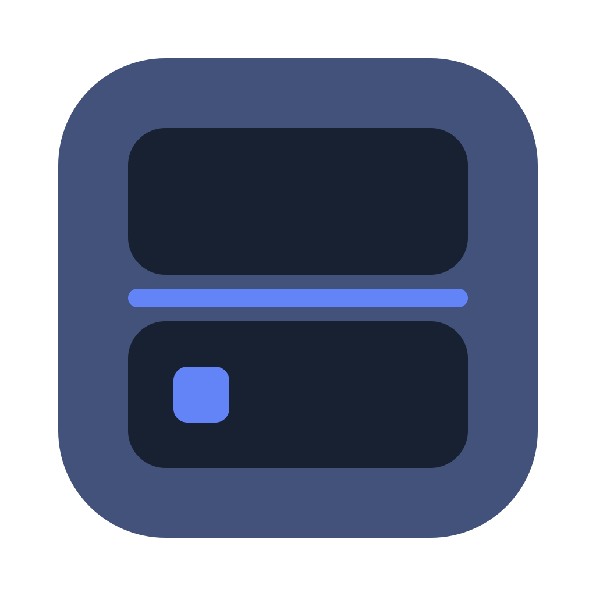
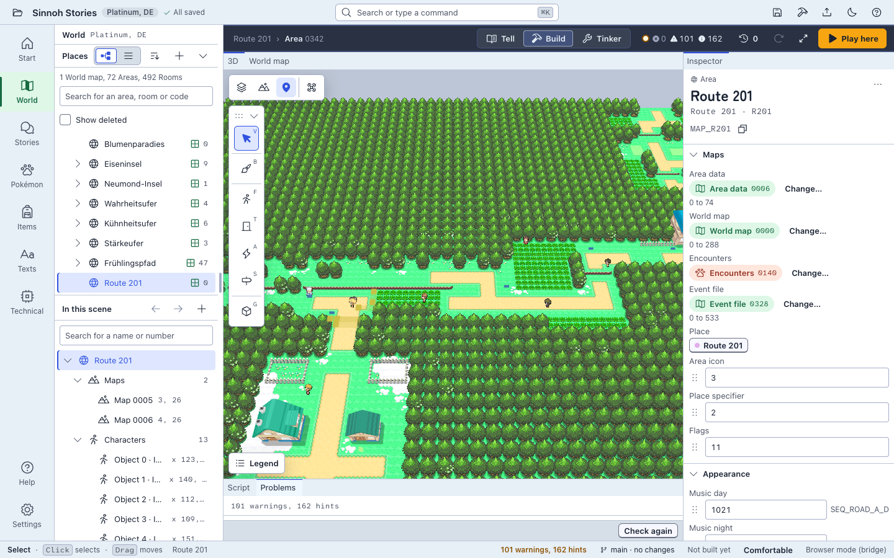
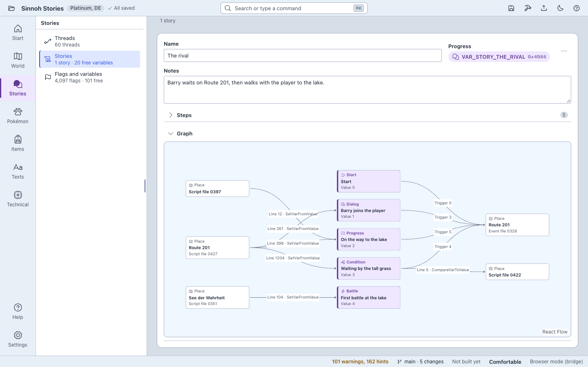
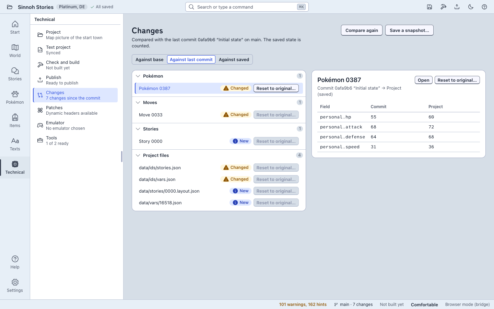

<p align="center">
  
</p>

# Gen4 Studio

English · [Deutsch](README.de.md)

Gen4 Studio is a modern, cross-platform editor for Pokémon Diamond, Pearl, Platinum, HeartGold and SoulSilver ROM hacks. Build worlds, stories, scripts and data from a text-based project, then compile to a ROM or xdelta patch. Works with AI agents via MCP.

[](LICENSE)
[](https://github.com/Kaago/gen4-studio/releases/latest)
[](https://github.com/Kaago/gen4-studio/actions/workflows/ci.yml)

<!-- section: about -->
## About

Gen4 Studio treats a ROM hack like a software project. You open your own ROM once, and from then on the hack is a folder of files: maps, scripts, texts and game data, which you can edit in the app, by hand, or with an AI agent, track in Git and read as plain text. When you are done, Gen4 Studio builds a ROM or an xdelta patch, so you can share your work without sharing the game.

It is made for people who want to build places and stories rather than edit tables: you work with places, figures, dialogs, doors and trainers, and Gen4 Studio takes care of headers, matrices, event files and archives behind them. The interface is available in English and German. It follows your system language and can be switched in Settings.

<!-- section: screenshots -->
## Screenshots



| Tell | Technical |
|---|---|
|  |  |

<!-- section: features -->
## What it does

- **World.** Explore places instead of tables: world map, areas and rooms, in 2D and 3D. Create new areas and rooms with wizards, edit headers, matrices, buildings, events and warps, and paint new maps from tiles with heights, ramps and smart drawing. Gen4 Studio bakes them to the game's model, terrain and collision data. PNG textures and OBJ or glTF models can be imported.
- **Tell.** Lay out stories as threads of steps tied to flags and variables. Place figures with dialog, doors, and trainers with their teams and battle texts, and see who else says a given line.
- **Scripts and text.** Edit event scripts in the rotom scripting language with a language server, and edit game text with a preview of the DS screen.
- **Data.** Edit Pokédex entries, moves, learnsets, evolutions, egg moves, items, trainers and encounters. Deleting something is blocked while anything still refers to it, and changed entities can be reset to their original state.
- **Checks.** Dozens of project checks across world, scripts, texts and data find problems such as broken references, missing messages and text that is too wide for the DS screen before the game does. Each finding says what to do, and several can be fixed with a preview and one undo step.
- **Build.** Build a ROM or an xdelta patch. An unchanged project builds a ROM identical to the one you started from. Play here builds and starts your emulator; Publish… writes a self-checked xdelta patch with a version and release notes.
- **Text project with Git.** Game data lives as JSON files, one entity per file, so changes show up as readable diffs. Gen4 Studio can set up a local Git repository and save snapshots.
- **Agents.** A built-in MCP server lets AI agents such as Claude Code read and edit the open project.
- **DSPRE projects.** Open an existing DSPRE project folder and keep using DSPRE next to Gen4 Studio.

<!-- section: games-platforms -->
## Supported games and platforms

| Game | Status |
|---|---|
| Pokémon Platinum | Verified with a German ROM. Other regions run through the same code but have not been tried. |
| Pokémon HeartGold | Verified with German and US ROMs. Other regions run through the same code but have not been tried. |
| Pokémon SoulSilver | Same engine family as HeartGold, no test project yet, not tried. |
| Pokémon Diamond and Pearl | Not enabled yet. Gen4 Studio recognises these ROMs but declines to create a project from them, because there is no test project. |

| Platform | Package | Notes |
|---|---|---|
| macOS 13 or later, Apple silicon (arm64) | DMG | Everything, including the live play mode. |
| Windows 10 or later, x64 | NSIS installer | Everything except the live play mode. |

Play here starts the emulator of your choice on both platforms; the first time, Gen4 Studio asks for one (melonDS, for example). The live play mode, which reads and sets flags and variables in the running game, needs melonDS 1.1 or later and works on macOS only. Linux is best effort and not part of the release builds.

<!-- section: install -->
## Install

Download the package for your system from the [latest release](https://github.com/Kaago/gen4-studio/releases/latest):

- macOS: `Gen4-Studio_<version>_aarch64.dmg`
- Windows: `Gen4-Studio_<version>_x64-setup.exe`

`SHA256SUMS.txt` on the same page lists the checksum of each file.

The packages are not signed with a developer certificate yet (macOS: ad-hoc signature, no notarization; Windows: unsigned), so your system warns you the first time you start the app.

**macOS (Gatekeeper).** Open the DMG and drag Gen4 Studio to Applications. On the first start, right-click the app and choose Open, then choose Open again in the dialog. Alternatively, open System Settings, Privacy & Security, and choose Open Anyway. Or remove the quarantine flag in a terminal:

```sh
xattr -dr com.apple.quarantine "/Applications/Gen4 Studio.app"
```

**Windows (SmartScreen).** Run the installer. If SmartScreen shows "Windows protected your PC", choose "More info", then "Run anyway". The installer needs no administrator rights and installs to `%LOCALAPPDATA%\Gen4 Studio`. If WebView2 is missing, the installer downloads it.

<!-- section: quickstart -->
## Quickstart

You need your own legally obtained ROM file (`.nds`) of Platinum, HeartGold or SoulSilver. Gen4 Studio contains no ROM data.

1. On the start screen, choose **New game from ROM…** (or drop the `.nds` file onto the window). Gen4 Studio reads the ROM and tells you whether it has been verified.
2. Choose a template: Original (the game as it is), Empty region with a starting town, or Data only. Pick a name and a folder, and let Gen4 Studio create the project. This unpacks the ROM into the project folder.
3. Open **Build** and create your first route: start the wizard for a new area, which copies existing maps into an area with its own place name. Switch to **Tell** to add a figure with dialog, a door or a trainer. **Technical** holds the checks, the build steps and the list of changes against the original.
4. Choose **Play here**. Gen4 Studio saves, builds and starts your emulator on the result. The first time, it asks which emulator to use.
5. Choose **Publish…** when you want to share the hack. Enter a version and release notes, and Gen4 Studio writes an xdelta patch against your base ROM, checks that it applies, and records the release. Share the patch, never the ROM.

<!-- section: agents -->
## Agents (MCP)

Gen4 Studio speaks the Model Context Protocol. An agent such as Claude Code reads and edits a project through the same commands the interface uses: a curated set of tools with English names and schemas, a few resources (a glossary, the MCP guide and the format descriptions) and three example prompts. Everything runs on your machine: over stdio when run headless, and over HTTP on `127.0.0.1` only when the app is running.

In the running app, the agent works in the project you have open, in the same session. Its steps appear in the history and can be undone like your own. You stay in control: access is off by default and is switched on in Settings › Agents, you grant it per project (none, read, or read and edit), the app asks on the first access and again before anything irreversible, and "read only" and "disconnect" are always at hand. To connect Claude Code to the running app:

```sh
# Use the path of the studio program of your installation.
claude mcp add gen4-studio -- "/Applications/Gen4 Studio.app/Contents/MacOS/studio" mcp

# Headless, without the app: the server opens the project itself.
claude mcp add gen4-studio -- "/Applications/Gen4 Studio.app/Contents/MacOS/studio" mcp --project "<project folder>"
```

The full guide, including tools, permissions and limits, is in [docs/en/mcp.md](docs/en/mcp.md). On Windows the app connection has not been verified yet.

<!-- section: project-format -->
## Project format

A Gen4 Studio project is a DSPRE project folder (the unpacked ROM) plus a text layer. In a text project, the game data is also kept as canonical JSON under `data/`, one entity per file with stable IDs, described by `g4-project.json`; texts and scripts stay in `expanded/`, and scripts are rotom sources. That makes a project easy to review, edit by hand and keep in Git: Gen4 Studio can set up `.gitignore` and `.gitattributes` and make snapshot commits, in a local repository only, never with a remote or a push. Text projects are available for Platinum, HeartGold and SoulSilver. A project contains data from the game, so keep it out of public repositories and share a patch instead. The format is documented in [docs/formats/text_project.md](docs/formats/text_project.md) (written in German, with an English summary at the top).

<!-- section: dspre -->
## Relationship to DSPRE

**Relationship to DSPRE.** Gen4 Studio would not exist without [DSPRE](https://github.com/DS-Pokemon-Rom-Editor/DSPRE), the DS Pokémon ROM Editor, and the years of reverse-engineering work by its maintainers and the DS hacking community. DSPRE is the reference for Gen IV format knowledge and served as our test oracle: Gen4 Studio produces byte-identical output on unchanged data. Gen4 Studio is an independent reimplementation in Rust and TypeScript and shares no code with DSPRE. It reads and writes the DSPRE project layout, so you can open an existing DSPRE project in Gen4 Studio and keep using both tools side by side. If you need the full breadth of DSPRE's roughly one hundred editors, DSPRE remains the right tool; Gen4 Studio focuses on world building, storytelling, scripts, a text-based project format, and agent integration.

<!-- section: acknowledgements -->
## Acknowledgements

Gen4 Studio builds on the work of the Gen 4 hacking community. Thank you to:

- [DSPRE](https://github.com/DS-Pokemon-Rom-Editor/DSPRE) and its maintainers, for the format knowledge and the tool every Gen 4 hacker knows.
- [ds-rom](https://github.com/AetiasHax/ds-rom), which extracts and builds DS ROMs.
- [uxie](https://github.com/KalaayPT/uxie) and nitroarc, the Rust library for Gen 4 project data and the Nitro archive library it ships.
- [rotom](https://github.com/KalaayPT/rotom) and rotom-lsp, the script language, compiler and language server behind the script editor.
- [chatot](https://crates.io/crates/chatot), for text archives.
- [apicula](https://github.com/scurest/apicula), which converts the games' 3D models.
- [pret](https://github.com/pret), for the [pokeheartgold](https://github.com/pret/pokeheartgold) and [pokeplatinum](https://github.com/pret/pokeplatinum) decompilations, a source of flag and constant names.
- [hg-engine](https://github.com/BluRosie/hg-engine), the engine hack that many HeartGold and SoulSilver projects build on.
- [PokeAPI](https://github.com/PokeAPI/pokeapi), for the species, move and item names.
- [melonDS](https://melonds.kuribo64.net/), the emulator behind Play here, and the [melonDS DS](https://github.com/JesseTG/melonds-ds) core our game tests run on.
- The [DS Pokémon Hacking Wiki](https://ds-pokemon-hacking.github.io/), for documenting how the games work.
- The Kingdom of DS ROM Hacking community, for years of shared knowledge.

<!-- section: legal -->
## Legal

Gen4 Studio contains no ROM data, no game assets and no copyrighted material from Nintendo, Game Freak or The Pokémon Company. You need your own legally obtained copy of the game. Pokémon and all related names are trademarks of their respective owners. This project is not affiliated with or endorsed by them.

<!-- section: build-contribute-license -->
## Building, contributing and license

**Building from source.** Gen4 Studio is a Rust workspace with a Tauri 2 app and a React and TypeScript front end. [docs/en/dev-setup.md](docs/en/dev-setup.md) explains the toolchain, how to run the app, and how to run the tests.

**Contributing.** Issues and pull requests are welcome. Please read [CONTRIBUTING.md](CONTRIBUTING.md) first, and never attach a ROM, a save game or any file derived from one.

**License.** Gen4 Studio is released under the [MIT License](LICENSE). The licenses of the components that ship with the app are included in its `licenses/` folder.
