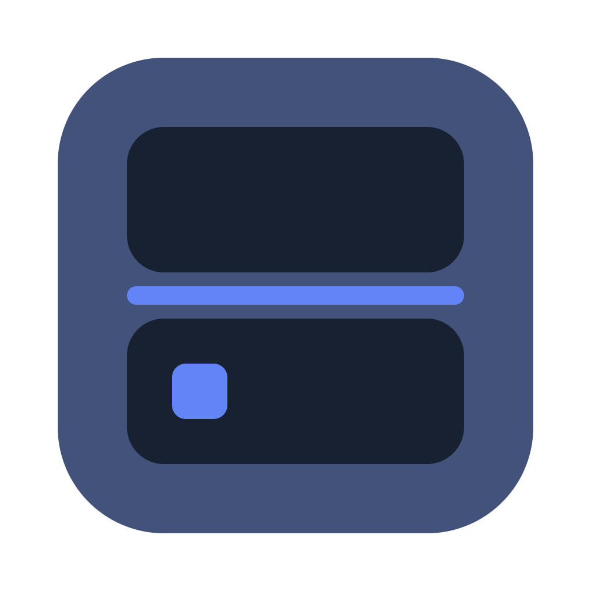

# Gen4 Studio Design-System „Doppeldeck“

Stand: 27.10.2026. Quelle der Gestaltung ist die OpenPencil-Datei [`Editor_DesignSystem.fig`](Editor_DesignSystem.fig). Quelle der Werte sind die DTCG-Tokens in [`tokens/`](tokens). Dieser Ordner liefert alles, was die Tauri-2-App (React, Dockview, three.js, CodeMirror/Monaco) zum Umsetzen braucht.

Gen4 Studio ist eine Engine, mit der Menschen eigene Pokémon-Spiele für den Nintendo DS erschaffen (Basis Platin, HeartGold, SoulSilver). Das Design-System richtet sich an zwei Gruppen zugleich: Einsteiger, die Orte, Figuren und Geschichten erzählen wollen, und Profis, die an Skripten und Rohdaten tüfteln. Es beschreibt den Zielzustand mit allen Features, nicht den heutigen Stand der App.

## Inhalt

| Pfad | Inhalt |
|---|---|
| `Editor_DesignSystem.fig` | OpenPencil-Datei: Titel (mit „Stand der App“), Grundlagen, Komponenten, Muster, vier Seiten „Zielbild: …“ und drei Seiten „App: …“ |
| `Audit-Design-System.md` | Abweichungen der App von der initialen Idee, mit Einordnung (bewusst, Lücke, Verbesserung) und offenen Entscheidungen |
| `tokens/` | Tokens im W3C-DTCG-Format, eine Datei je Sammlung und Modus (wie OpenPencil/Figma sie exportiert) |
| `apps/studio/src/ui/tokens/tokens.css` | Alle Tokens als CSS-Variablen `--g4-*`, Hell als Standard, Dunkel über `data-theme`, Kompakt über `data-dichte` |
| `apps/studio/src/ui/tokens/dockview-theme.css` | Dockview-Thema `dockview-theme-g4`, gespeist aus den Tokens |
| `apps/studio/src/ui/tokens/tokens.ts` | Hex-Werte für three.js, Monaco/CodeMirror und Canvas: Szene, Themen, Syntax, Pokémon-Typen (`typen`, aus der Szene-Gruppe `typ`), `rgb555()` |
| `scripts/export_tokens.py` | Erzeugt die drei Dateien oben aus `tokens/`; Aufruf über `pnpm tokens` (in `apps/studio`), Ausgabeordner als zweiter Parameter |
| `marke/` | Die Marke (App-Symbol): `gen4-studio-marke.svg` (Quelle) und `gen4-studio-marke-1024.png`, beide erzeugt von `scripts/marke.py`; Abschnitt „Marke“ |
| `scripts/check_tokens.py` | Prüft RGB555-Treue und WCAG-Kontraste aller wichtigen Paare in beiden Themen |
| `scripts/fix_fig_text.mjs` | Repariert nach dem Speichern in OpenPencil verstümmelte Texte und rastet mit `--rgb555` alle Farben der `.fig` auf das DS-Raster |
| `openpencil/jsx-lib.js` | JSX-Bausteine des Zielbilds (Fenster, Atlas, Scharnier, Statusleiste, Inspector, DS-Bildschirm …), mit denen die Zielbild-Screens gebaut sind |
| `openpencil/BRIEFING-SCREENS.md` | Briefing für neue Zielbild-Screens: Konzept, Raster, Regeln, Tokens, Sprache |
| `openpencil/jsx-lib-app.js` | JSX-Bausteine mit den Maßen der App (CSS-Module in `apps/studio/src/ui`), für die Seiten „App: …“ und die Bretter „Komponenten (App)“; `dunkel-map.js` davor liefert das dunkle Thema als Hex |
| `openpencil/BRIEFING-APP-SCREENS.md` | Briefing zum Nachzeichnen der App aus Screenshots der Test-Umgebung; Beispiel in `openpencil/beispiele/` |
| `openpencil/build-screen.sh`, `scripts/op.mjs` | Baut aus Bibliothek und Screen-Datei ein JSX und ruft damit den OpenPencil-MCP-Server direkt auf (`render`, `export_image` mit `--png` …), ohne riesige Aufrufe |

Ablauf bei Änderungen: Token in `tokens/*.json` ändern, `python3 design-system/scripts/check_tokens.py`, dann `pnpm tokens` (in `apps/studio`, schreibt die drei generierten Dateien nach `apps/studio/src/ui/tokens/`), dann `bash scripts/check-tokens.sh` aus der Repo-Wurzel (Raster, Kontraste und Abgleich der eingecheckten Dateien mit einem frischen Export; läuft auch im Gate), dann die geänderten Dateien in OpenPencil über „Design-Tokens importieren“ (MCP `import_design_tokens`) einspielen. OpenPencil legt fehlende Variablen an und aktualisiert vorhandene über den Namen.

## Prinzipien

1. **Zeigen und anfassen.** Die *Schau* zeigt, was der Spieler sehen wird: 3D-Welt, DS-Bildschirm, Story-Graph, Pokédex-Profil. Die *Hand* hält, was man anfasst: Hierarchie, Inspector, Formulare, Listen, und als schwebende Leiste die Werkzeuge auf der Schau. Beide spiegeln dieselbe Auswahl. Jeder Bereich hat ein Dock: die Schau ist darin eine Gruppe in der Mitte, die Gruppen der Hand liegen daneben oder darunter, wie die Anordnung sie legt. In der Welt ist das die „Werkbank“: die Hand steht an den Rändern (links die Hierarchie in der Liste, rechts der Inspector über die volle Höhe, unter der Schau Script und Probleme); in Texten und Daten das „Doppeldeck“: die Hand liegt unter der Schau wie beim DS. Jeder darf die Hand umordnen, schweben lassen und maximieren; die Schau bleibt angedockt in der Mitte.
2. **Das Scharnier weiß, wo du bist.** Eine dunkle Leiste über dem Dock, sein Kopf, trägt Ort und Auswahl, die Tiefe, das Prüflicht, den Verlauf, „Schau maximieren“ und „Hier spielen“; darunter die Reiter der Gruppen. Im Assistenten wird sie zur Schrittleiste, im Spielmodus bernsteinfarben. Das ist die eine Signatur des Systems; alles andere bleibt ruhig.
3. **Erzählen, Bauen, Tüfteln.** Statt eines Expertenmodus hat jeder Bereich eine Tiefe. Erzählen nutzt Rezepte und Wörter wie Ort, Figur, Geschichte. Bauen zeigt den vollständigen Inspector, Malen und Graph. Tüfteln zeigt Skripte, Hex-Werte, Header und Matrizen.
4. **Zwei Sprachebenen.** Vorne steht das Wort des Spieleerstellers, dahinter grau und in Mono die technische Kennung: „Haus des Rivalen `T01R0102`“. So lernt man Gen-4-Begriffe nebenbei.
5. **DS-treue Farbe.** Jede Farbe liegt im 15-Bit-Raster des DS (RGB555, Kanalwerte `(v << 3) | (v >> 2)`). Was der Editor zeigt, kann das Spiel darstellen.
6. **Nie nur Farbe.** Status trägt Symbol und Text, Szenen-Overlays tragen Muster und Form, Pokémon-Typen tragen ihren Namen.
7. **Rezepte statt leerer Leinwand, Wege statt Nummern.** Assistenten erzeugen normale, weiter bearbeitbare Objekte. Wo das Spiel eine ID erwartet, wählt man per Picker mit Namen und Vorschau. Jede Referenz ist ein klickbarer Weg mit „Verwendet in“.
8. **Reversibel sichtbar.** Alles ist mit ⌘Z umkehrbar, außer dem, was sofort auf Platte geht (neue Karten, Patches). Das trägt die Plakette „Nicht rückgängig“, und vorher entsteht ein Schnappschuss.

## Fensterraster

```
┌ Titelleiste 40: Ampel oder Fensterknöpfe, Projekt mit Spiel und Speicherstand, Suche ⌘K, Speichern, Bauen, Veröffentlichen, Thema, Hilfe
├ Atlas 88 ┬ Liste 272 (optional)       ┬ Scharnier 44 (Kopf des Docks, ohne Griff, nicht ziehbar)
│          │ Welt: ┌ „Orte“             ├ Dock des Bereichs (wächst): Gruppen mit Reitern (28, Kompakt 24), dazwischen Dockviews Sashes
│          │       ├ Teiler „Höhe der   │   Werkbank (Welt):  ┌ Schau: 3D, Weltkarte         ┐ Inspector 340 (280 bis 480),
│          │       │ Orte“ 8            │                     │ (in 3D die Werkzeugleiste)   │ volle Höhe rechts
│          │       └ „In dieser Szene“  │                     └ Script, Probleme 240         ┘
│          │                            │   Doppeldeck:       ┌ Schau
│          │                            │                     └ Bearbeiten 286 (Welt: Inspector, Script, Probleme)
│          │                            └ Schritt des Assistenten 286 (nur solange einer offen ist)
└ Statusleiste 28: aktives Werkzeug mit Kürzeln, Kontext, Build-Stand, Dichte
```

- Die Schau der Welt hat in Bauen die Reiter „3D“ und „Weltkarte“; in Tüfteln kommt „Raster“ dazu (seit 3f.1, nie vorn beim Wechsel).
- Referenzgröße 1440 × 900. Mindestgröße des Fensters 1100 × 720 (Windows: `minWidth` höchstens 500 halten, sonst bricht Snap; die App selbst skaliert ab 1100 sinnvoll). Gemessen in 1440 × 900, Werkbank: Schau-Gruppe 740 × 548, Script und Probleme 240 hoch darunter, Inspector 340 × 788; Doppeldeck: Schau 1080 × 502, die Gruppe darunter 286. In 1100 × 720 hält der Inspector 280 bis 340 px; schmaler als 360 px stellt eine Inspector-Zeile ihre Bezeichnung über das Feld (Container-Abfrage `inspector`), und die Werkzeugleiste liegt in der niedrigen Schau flach unter den „Ebenen der Schau“.
- In der Welt hat die Liste zwei Abschnitte unter dem Kopf „Welt“: oben „Orte“ (der Weltbaum, auf eine Zeile einklappbar), unten „In dieser Szene“ (die Hierarchie des gezeigten Gebiets oder Raums), dazwischen ein waagrechter Teiler „Höhe der Orte“ (Anteil 0,2 bis 0,8 der Höhe, jeder Teil mindestens 96 px). Die Listen der anderen Bereiche haben diese Teilung nicht. Die Liste liegt außerhalb des Docks; sie lässt sich ein- und ausklappen, nicht andocken.
- Die Gruppen des Docks werden durch 1-px-Linien getrennt (`linie/leise`), nicht durch Karten. Angedockte Flächen haben keinen Schatten und keine Rundung; nur eine schwebende Gruppe hat Rand, Ecken und Schatten wie ein Fenster.
- Der Atlas hat Start und sechs Bereiche: Welt, Geschichten, Pokémon, Gegenstände, Texte, Technik. Die Bereichsfarbe färbt Atlas-Eintrag, Referenz-Chips, Assistenten-Kopf und Story-Knoten.
- Dockview: ein Dock je Bereich mit Deck (Welt, Texte, Pokémon, Gegenstände), jedes eine eigene Dockview-Instanz mit eigenem Layout. Die Schau ist eine Gruppe darin, die übrigen Panels liegen in Gruppen daneben oder darunter. Das Scharnier ist eine eigene React-Leiste über dem Dock, kein Panel. Einen eigenen Teiler zwischen Schau und Hand gibt es nicht mehr: die Grenzen zwischen den Gruppen sind Dockviews Sashes. Profis dürfen Panels umdocken, schweben lassen und maximieren; die Schau-Panels bleiben in ihrer Gruppe.

## Tokens

Sammlungen (in OpenPencil und `tokens/`):

| Sammlung | Modi | Inhalt |
|---|---|---|
| Primitiv | Wert | Rampen Platin (Neutrale), Kobalt, Bernstein, Signal, Moos, Zerr, Koralle, Lagune, Sand |
| Szene | Wert | Gelände-, Ereignis-, Höhen- und Auswahlfarben für three.js, Gruppe `ds` für den DS-Bildschirm, Gruppe `typ` für die 18 Pokémon-Typen, Gruppe `status` für Prüfbefunde an Markern; gleich in beiden Themen |
| Thema | Hell, Dunkel | Semantik: `flaeche/*`, `text/*`, `linie/*`, `akzent/*`, `auswahl/*`, `fokus/ring`, `live/*`, `scharnier/*`, `status/*`, `bereich/*`, `schatten/*` (Typ `shadow`: `schatten/schwebend`, Platin 1000 mit 24 % in Hell, 48 % in Dunkel; als CSS `--g4-schatten-schwebend`, nicht in `tokens.ts`) |
| Raum | Wert | `raum/0…64` (Pixel im Namen), `radius/feld|taste|bildschirm|fenster|plakette`, `strich/*`, `schrift/groesse/*`, `schrift/zeile/*` |
| Dichte | Komfort, Kompakt | `dichte/steuer`, `zeile`, `zeile-innen`, `panel-innen`, `feld-abstand`, `scharnier`, `symbol`, `werkzeug`, `reiter` (seit 3e.4: die Reiterleisten des Docks, Komfort 28, Kompakt 24; `dockview-theme.css` setzt damit `--dv-tabs-and-actions-container-height`) |
| Bewegung | Wert | `dauer/sofort|kurz|mittel|scharnier` (0/120/200/280 ms) |
| Schrift | Wert | `familie/ui|titel|code|spiel` |
| Textstile | – | `text/xs…l`, `titel/s…l`, `code/s`, `spiel/textbox` |

Regeln:
- Komponenten benutzen nur Thema-, Raum- und Dichte-Tokens, nie Primitive oder Hex.
- **Bernstein 500 gehört allein dem Spielen** (Spielen-Taste, Spielmodus, Live-Werte). Warnungen benutzen `status/warnung` (Bernstein 750) und ein Symbol.
- Wer schwebt, hat Schatten (`schatten/schwebend`, Rand `linie/standard`); wer andockt, nie: Menü, Tooltip, Dialog, Popover, Toast, Szenenleiste, Werkzeugleiste, das Reitermenü des Docks und die schwebende Dock-Gruppe (dazu `radius/fenster`; `dockview-theme.css` setzt `--dv-floating-box-shadow` auf `schatten/schwebend`).
- Kobalt heißt: das bist du gerade (Auswahl, Fokus) oder das passiert, wenn du klickst (primäre Taste). Höchstens eine primäre Taste pro Ansicht.
- Kontraste: Text und Status auf allen Flächen mindestens 4,5 : 1, Steuerkanten (`linie/stark`) und Fokusring mindestens 3 : 1. `scripts/check_tokens.py` prüft das für beide Themen.
- Dark Mode folgt dem System, außer `data-theme="hell"` oder `data-theme="dunkel"` ist gesetzt. Kompakt über `data-dichte="kompakt"` am `html`-Element. Bei `prefers-reduced-motion` werden alle Dauern 0 ms (Überblendung statt Bewegung). Bei `forced-colors` übernehmen Systemfarben Fokus und Akzent.

## Typografie

| Rolle | Schrift | Einsatz |
|---|---|---|
| Oberfläche | Atkinson Hyperlegible Next | Alles, was man liest und bedient. Basis 13/18, nie unter 12 px. Eindeutige Formen für I, l, 1, 0. Tabellenziffern. |
| Titel | Zen Maru Gothic (700/900) | Ortsnamen, Assistententitel, Kopf von Editoren und leeren Zuständen. Höchstens ein großer Titel pro Ansicht. |
| Code und Kennungen | Atkinson Hyperlegible Mono | Skripte, Hex-Werte, technische Namen hinter dem Klartext. |
| Stimme des Spiels | Pixelify Sans | Nur in DS-Bildschirm-Vorschauen (Textbox, Schild, Menü). |

Skala: 12/16, 13/18, 15/20, 18/24, 24/30, 32/38, 44/52. Alle Schriften stehen unter der SIL Open Font License und werden mit der App ausgeliefert (CSP erlaubt nur `self`): `@fontsource-variable/atkinson-hyperlegible-next`, `@fontsource/atkinson-hyperlegible-mono`, `@fontsource/zen-maru-gothic` (700, 900; nur Latin-Teilmenge), `@fontsource/pixelify-sans`. Auf Windows statische, gehintete Schnitte bevorzugen.

Symbole: Phosphor Icons (MIT), Stil „regular“ für Oberfläche, „fill“ für Marker in der Welt. In der App erben Symbole `currentColor`.

## Marke

Die Marke von Gen4 Studio ist das Doppeldeck selbst, auf das Nötigste gebracht: zwei Bildschirme übereinander, dazwischen das Scharnier als Kobaltlinie, die eine Signatur des Systems (Prinzip 2). Unten, auf der Hand, ein Kobaltquadrat: die Auswahl, „das bist du gerade“. Flache Farben, fünf Formen, keine Kontur, kein Schatten, keine Textur. Sie ist das App-Symbol (Dock, Finder, „Über Gen4 Studio“); eine Ziffer „4“ trägt sie nicht, Name und Generation stehen daneben.



Konstruktion im Raster 1024 × 1024 (Maße in Pixeln):

| Form | Maß | Token |
|---|---|---|
| Körper | 824 × 824 bei 100/100 (100 px Rand rundum, Raster der macOS-App-Symbole), Radius 184; kein Schatten | `scharnier/grund` |
| Bildschirme | je 584 × 252 bei x 220, oben bei y 220, unten bei y 552; 120 px vom Körperrand rundum, der Block aus beiden Bildschirmen ist quadratisch; Radius 64 = 184 − 120, konzentrisch zum Körper | `szene/ds/grund` |
| Scharnier | Linie 584 × 32 bei y 496, mittig auf 512 im Abstand 80 zwischen den Bildschirmen (24 px Körper darüber und darunter), runde Enden (Radius 16) | `akzent/grund` |
| Auswahl | Quadrat 96 × 96 im unteren Bildschirm, links, oben und unten je 78 px vom Bildschirmrand (bei 298/630), Radius 24 | `akzent/grund` |

Farben (Thema Dunkel und Szene, alle auf dem RGB555-Raster, Prinzip 5):

| Token | Wert | Rolle |
|---|---|---|
| `scharnier/grund` (Dunkel) | `#42527B` | Körper: das Gehäuse in der Farbe des Scharniers |
| `szene/ds/grund` | `#182131` | beide Bildschirme, der Grund des DS-Bildschirms |
| `akzent/grund` (Dunkel) | `#6384F7` | Scharnier und Auswahl, der einzige Akzent |

Die Spec nannte für den Körper `scharnier/flaeche`; dieses Token gibt es nicht, die Fläche des Scharniers heißt `scharnier/grund`. Jede Farbe im SVG trägt ihr Token im `id` der Gruppe (`token-scharnier-grund`, `token-szene-ds-grund`, `token-akzent-grund`); nach einer Token-Änderung `python3 design-system/scripts/marke.py` laufen lassen und die Symbole neu erzeugen (`docs/release.md`, Abschnitt „App-Symbol“).

- **Schutzraum:** um den Körper ein Viertel des Scharnier-Abstands frei, 20 px bei 824; in Dokumenten und auf Flächen der App mindestens 1/8 der Körperbreite (103 px bei 824).
- **Hell und Dunkel:** ein Symbol für beide (Tauri 2 kennt nur eins). Der Körper in Platin 700 steht auf hellem Dock und Finder als dunkle Form und auf dunklem Dock als hellere; eine Kontur braucht er darum nicht. Die Ecken außerhalb des Körpers sind durchsichtig; dieselbe Datei taugt ohne Änderung für Flächen der App (Galerie, späterer Über-Dialog).
- **Kleine Größen:** bei 32 px bleiben Körper, die zwei Bildschirme, die Kobaltlinie und die Auswahl erkennbar, bei 16 px Körper, zwei dunkle Flächen, die Linie als heller Streifen und die Auswahl als Kobaltpunkt. Die Linie ist 32 px dick (eine Pixelzeile bei 32 px), die Auswahl 96 px (drei Pixel bei 32, anderthalb bei 16). Kein eigenes Kleinsymbol: `tauri icon` skaliert aus 1024.
- **Dateien:** `marke/gen4-studio-marke.svg` (Quelle, fünf `<rect>` in drei Gruppen, ohne eingebettete Bilder) und `marke/gen4-studio-marke-1024.png` (1024 × 1024, RGBA, sRGB). Beide schreibt `scripts/marke.py` aus einer Geometrie, nur mit der Standardbibliothek (eigener Rasterizer mit 4 × 4-Supersampling an den Rundungen, PNG über `zlib`); gleicher Lauf, gleiche Bytes. Tests: `python3 -m unittest design-system/scripts/test_marke.py` (Maß und Farbtyp des PNG, Farben als Token auf dem RGB555-Raster, Palette und Zahl der Formen, Maße und Konzentrik, SVG gleich Geometrie, Determinismus).
- **OpenPencil:** Brett „Marke“ auf der Seite „Grundlagen“ der `.fig`, bei x 1720, y 2900 rechts neben „Grundlagen: Stand der App“ (Vorlage `openpencil/beispiele/marke.body.js`, Anleitung `openpencil/NACHTRAG-4-0.md`): die Konstruktion mit Maßlinien (Rand 100, Körper 824, Bildschirme 584 × 252 mit 120 zum Körperrand, Abstand 80, Auswahl mit je 78, Radien 184, 64, 16, 24), Formen und Farben, die Marke in 1024 (1:4 gezeichnet), 128, 32 und 16 px auf Hell und auf Dunkel, der Schutzraum (20 px im Symbol, 103 px in Dokumenten) und der Einsatz.

## Komponenten (Seite „Komponenten“)

| Komponente | Varianten und Eigenschaften | Umsetzung |
|---|---|---|
| Taste | Art Primär, Sekundär, Leise, Spielen, Gefahr × Zustand Ruhe, Hover, Fokus, Gesperrt; Beschriftung, Symbol | `<Taste art>`; sekundär mit doppelter Unterkante; Fokus 2-px-Ring außen; Gesperrt auch als `aria-disabled` (sieht gesperrt aus, behält aber den Fokus, für eine Taste, deren Aktion gerade läuft; seit 4.0) |
| Symboltaste | Ruhe, Hover, Aktiv, Gesperrt | immer mit Tooltip (Name + Kürzel) |
| Tastenkürzel | Hell, Auf Scharnier | in Tooltip, Menü, Statusleiste, Picker-Fuß |
| Eingabefeld | Ruhe, Fokus, Fehler, Gesperrt; Bezeichnung, Wert, Hinweis | Fehlertext sagt den Ausweg |
| Zahlfeld | Dez, Hex | Scrubbing an der Bezeichnung (Pointer Capture), Bitbreite prüfen, nie still abschneiden |
| Auswahlfeld | Ruhe, Offen | kurze feste Listen mit Symbol; lange Listen über Picker |
| Schalter, Kästchen | An/Aus, An/Aus/Gemischt | Schalter wirkt sofort |
| Segmente | Erzählen, Bauen, Tüfteln | zwei bis vier gleichrangige Optionen |
| Reiter | Aktiv, Ruhe, Ungespeichert | Kobalt-Punkt statt Schließen bei Ungespeichertem |
| Dock-Reiter | Ruhe, Sichtbar (in einer anderen Gruppe), Aktiv (Gruppe mit Fokus), Ungespeichert; Kontextmenü; Reiter der Schau | Dockviews Reiter im Thema `dockview-theme-g4`: Höhe `dichte/reiter` (Komfort 28, Kompakt 24), Fläche `flaeche/gehaeuse`, Text 13 px `text/sekundaer`. Der sichtbare Reiter jeder Gruppe trägt die 2-px-Kobaltkante oben, in der Gruppe mit Fokus dazu `flaeche/schau` und `text/primaer`. Ungespeichert: der Kobalt-Punkt (8 px, `akzent/grund`, Name „ungespeichert“) hinter dem Titel, heute nur am Reiter „Script“. Kein Schließen: ein Panel lässt sich verschieben, nicht schließen. Doppelklick maximiert die Gruppe oder stellt sie wieder her. Rechtsklick oder Umschalt+F10 öffnet das Kontextmenü (`ui/frame/dockMenu.ts`): „Maximieren“ oder „Wiederherstellen“ (gesperrt in einer schwebenden Gruppe), „Schweben lassen“ (gesperrt, solange das Panel schwebt), „Zurück ins Dock“ (nur schwebend), Trenner, „Anordnung zurücksetzen“. Ein Reiter der Schau (3D, Raster, Weltkarte, die Vorschauen) hat nur „Maximieren“ oder „Wiederherstellen“; er lässt sich anklicken, nicht wegziehen. Die Ansagen für Screenreader sind deutsch („Inspector schwebt“, „Inspector angedockt“, „… maximiert“, „… wiederhergestellt“; `ui/frame/dockMessages.ts`) |
| Referenz | Bereich Welt … Technik; Name | klickbar, Rechtsklick „Verwendet in“ |
| Zustand | Ungespeichert, Nicht rückgängig, Gesperrt, Auf Platte geändert, Nur Platin und HGSS, Fehler, Live | überall, wo das Asset erscheint |
| Typ | 18 Typen der 4. Generation | Farbe plus Name; Farben aus `szene/typ/<schluessel>/{grund,schrift}`, unbekannte Nummer als „Typ 19“ auf `flaeche/deck` |
| Meldung | Info, Erfolg, Warnung, Fehler; Titel, Text, Aktion | im Panel, im Assistenten oder als Toast unten rechts |
| Wertebalken | Über Schnitt, Unter Schnitt | Wert bis 255, Strich für den Durchschnitt |
| Budget | Ruhig, Knapp, Voll | DS-Grenzen ruhig zeigen, Speichern blockiert nie |
| Listenzeile, Baumzeile | Ruhe, Hover, Gewählt, Gezeigt, Befund, Gesperrt / im Ortsbaum: Weltkarte, Gebiet, Raum, Gruppe („Weitere Gebiete“, „Nicht verbunden“, „Sonstiges“); in der Szene: Gebiet oder Raum als Wurzel, Karte, Gebäude, Figur, Tür mit Ziel (zweite Zeile „→ Ziel“), Auslöser, Schild, Script, Gruppe mit Zähler | Name vorne, Kennung grau (in Bauen der Klarname, in Tüfteln dazu Nummer und Kürzel); ein Raum eines anderen Ortes trägt das Ortsetikett: 8-px-Punkt in der Ortsfarbe plus Ortsname grau, nie Farbe allein; rechts Zähler (Gebiete, Räume) und am gewählten Raum das Menü „Weitere Aktionen für …“; ein Raum, dessen Karten auch andere Räume nutzen, trägt ein kleines Symbol mit Namen „geteilt“ (Titel „Geteilt mit 16 Räumen“, seit 3f.4). Ein Gebiet ohne Räume (und in Tüfteln ohne Abschnitte) ist ein Blatt, ohne Pfeil. **Gezeigt:** die Zeile, deren Raster die Schau zeigt, trägt am Ende ein Symbol mit Namen (`ShownMark`), nicht Kobalt. **Gewählt:** Kobalt, wie überall. **Befund:** ein Zeichen mit Namen am Zeilenende (Fehler vor Warnung); an der Wurzel der Szene der schlimmste Befund des Headers, an den Ereigniszeilen der Fehler der Prüfungen. **Gesperrt:** die Plakette „Gesperrt“ an den vier Ereignisgruppen, solange die Eventdatei schreibgeschützt ist. Die Szenenzeilen tragen das Symbol ihrer Art (Karte, Gebäude, Figur, Tür, Auslöser, Schild, Script) und grau, wo das Ding steht („x 11, z 21“; die Karte „Karte 0411 · Zelle 0, 0“); die Tür hat zwei Zeilen: „Warp 0“ und darunter „→ Haus 1“ (unbekanntes Ziel: „→ unbekanntes Ziel 0999“, in Tüfteln „→ Header 0414 · Haus 1“). Die Gruppe ist ein Wort mit dem Zähler rechts, keine Versalien |
| Hierarchie | Wurzel Gebiet oder Raum, Gruppen Karten, Figuren, Türen, Auslöser, Schilder, Scripts; Ruhe, Suche, Leer, Eventdatei gesperrt | der Abschnitt „In dieser Szene“ der Liste „Welt“: Panelkopf mit „Zurück“ (⌥⌘←), „Vor“ (⌥⌘→) und dem Menü „Hinzufügen“ („+“ wählt das Werkzeug Figur, Tür, Auslöser, Schild oder Gebäude, dazu „Raum hier anbinden…“ und seit 3f.2 „Neuer Ort…“, der den Dialog „Neuer Ort“ für das Gebiet oder den Raum der Szene öffnet; die Ereignisse gesperrt mit Grund, wenn auch die Werkzeuge es sind), darunter das Suchfeld „Name oder Nummer suchen“ und der Baum (`role="tree"`, Name „In dieser Szene“, Roving, Pfeil rechts und links öffnen und schließen). Alles ist offen, nur die Gebäude einer Karte sind zu. Eine Gruppe ohne Zeilen fehlt. Ein Klick wählt wie ein Klick in der Szene, ein Script öffnet seinen Reiter, Enter oder Doppelklick auf eine Tür mit bekanntem Ziel zeigt die Szene des Ziels. Die Suche behält Zeilen, deren Titel oder Kennung (auch das Ziel einer Tür) passt, und lässt Gruppen und Karten mit Treffern offen; das Gruppenwort behält alle Zeilen der Gruppe. Eine gesperrte Eventdatei steht als Meldung „Eventdatei gesperrt“ unter der Suche. Ohne gezeigte Szene der leere Zustand „Noch keine Szene gezeigt.“ |
| Inspector-Kopf | Art Figur, Tür, Auslöser, Schild, Gebäude, Karte, Gebiet, Raum, Ort, Aussehen × Zustand Ungespeichert, Gesperrt, Nicht rückgängig; mit und ohne Menü | der Kopf, den jede Ansicht des Inspectors teilt (`InspectorHead`): links die Augenbraue, das Typ-Wort in Satzschreibung mit Symbol davor (`text/xs`, `text/sekundaer`, keine Versalien; in Tüfteln „Header“ für Gebiet, Raum und Ort, „Area-Data“ für das Aussehen), der Titel (`titel/s`, Zen Maru Gothic, eine Zeile) und grau in Mono die Kennung („Objekt 2 · Eventdatei 0390“, `code/s`); rechts die Plaketten der Zustände und das Menü „Aktionen“ (Symbol „Mehr“, am rechten Ende; ohne Einträge fehlt es). Die Einträge heißen nach dem, was passiert: Karte „Teile importieren…“, „Teile exportieren…“, „Duplizieren“; Figur, Tür, Auslöser, Schild und Gebäude „Löschen“ mit Entf (gesperrt bei schreibgeschützter Eventdatei); Gebiet und Raum „Raum hier anbinden…“ und „Ort umbenennen…“ (gesperrt bei „Kein Ort“ und bei Diamant/Perl), ein geteilter Raum dazu „Für diesen Raum abspalten…“. Plaketten der Zustände: Ungespeichert, Gesperrt, Nicht rückgängig, an einem geteilten Raum „Geteilt mit N Räumen“ (siehe „Plakette „Geteilt““). Der Rand unten ist eine 1-px-Linie `linie/leise`, der Kopf schwebt nicht |
| Inspector-Zeile | Text, Auswahl, Zahl, Schalter, Referenz, Flags; Abweichung | Bezeichnung 116 px, Kobalt-Strich bei Abweichung von der Vorlage |
| Scharnier | Bearbeiten, Assistent, Spielen; Lage oben, ohne Griff, nicht ziehbar; „Schau maximieren“ Ruhe, Gedrückt | eigene React-Komponente, 44 px über dem Dock, sein Kopf; Übergang 280 ms; Tokens `scharnier/*`. Rechts: Prüflicht, Verlauf, Wiederholen, die Symboltaste „Schau maximieren“ (`aria-pressed`, gedrückt, solange die Schau-Gruppe maximiert ist; ein zweiter Druck, Esc oder ein Doppelklick auf einen Schau-Reiter stellt wieder her), dann „Hier spielen“ |
| Schwebende Gruppe | Titelleiste (Griff), Reiter, Inhalt; mit und ohne Fokus | Dockviews schwebende Gruppe im Thema `dockview-theme-g4`: ein Blatt (`flaeche/blatt`), Rand `linie/standard`, `radius/fenster`, `schatten/schwebend`; oben die Titelleiste (22 px, `flaeche/deck`, Linie `linie/standard`) als Griff zum Ziehen, darunter die Reiter. Entsteht über „Schweben lassen“ im Reitermenü, die Palette „Inspector schweben lassen“ oder Umschalt-Ziehen eines Reiters; aus dem Menü und der Palette 340 × 480 am rechten Rand der Schau (16 px Abstand), dort verankert. Sie bleibt im Fenster, auch wenn es nach dem Neuladen kleiner ist. Nie ein Schau-Panel: 3D, Raster, Weltkarte und die Vorschauen schweben nicht, ein gespeichertes Layout mit schwebender Schau wird verworfen. „Zurück ins Dock“ und „Inspector andocken“ setzen das Panel an seinen Platz der Anordnung |
| Werkzeugleiste, schwebend | Ausrichtung senkrecht, waagrecht × Dichte Komfort, Kompakt; Anker Links, Oben, Unten; Werkzeug Ruhe, Hover, Aktiv, Gesperrt; Gruppen-Trenner | Overlay der 3D-Ansicht, `flaeche/blatt`, Rand `linie/standard`, `schatten/schwebend`, `radius/taste`; Taste `dichte/werkzeug` (40/32); `role="toolbar"` mit Roving; Griff (nur Zeiger) und Menü „Lage der Werkzeugleiste“; ab 460 px (Kompakt 400 px) Höhe der Ansicht senkrecht, darunter oben |
| Teiler | waagrecht, senkrecht; Ruhe, Hover, Fokus | `role="separator"` mit `aria-orientation`, 8 px, Linie `linie/leise`, `aria-valuenow` in px. Ziehen beginnt erst nach 4 px (kürzere Wege sind ein Klick, kein Zug); Pfeiltasten ±16 px entlang seiner Achse (waagrecht hoch und runter, senkrecht links und rechts; die Taste in Wachstumsrichtung des ersten Teils vergrößert ihn), Pos1 den Höchstwert, Ende den Mindestwert; Enter und Doppelklick bestimmt der Besitzer. Zwischen den Gruppen des Docks gibt es seit 3e.4 keinen eigenen Teiler mehr (bis dahin „Höhe der Hand“, 200 bis 560 px): die Grenzen dort sind Dockviews Sashes, eine 1-px-Linie `linie/leise`, ziehbar; der Baustein `Splitter` dient der Liste. In der Liste „Welt“ („Höhe der Orte“): der Anteil der Orte 0,2 bis 0,8 der Höhe (gemerkt in `g4.shell.v1`), jeder Teil mindestens 96 px, Doppelklick halbiert |
| Titelleiste | macOS, Windows | macOS `titleBarStyle: "Overlay"` + natives Menü; Windows `decorations: false`, eigenes Menü und Fensterknöpfe |
| Atlas-Eintrag | 7 Bereiche × Ruhe/Aktiv | 88 px breite Leiste |
| Werkzeug-Taste, Rezept-Taste | Ruhe, Hover, Aktiv, Gesperrt / 4 Bereiche | Werkzeuge in Bauen: Symbol mit dem Buchstaben in der Ecke, ohne Namen unter dem Symbol; Name im Tooltip und in der Statusleiste; `data-tool`. Rezepte in Erzählen |
| Statusleiste | – | lehrt Kürzel des aktiven Werkzeugs; rechts vor dem Bauen-Stand seit 3h.3 die Agenten-Zeile (nur solange ein Agent verbunden ist) |
| DS-Bildschirm | Textbox, Schild, Leer | 256 × 192, ganzzahlig skaliert, Spielschrift |
| Projektkarte | Bild eigen, Standardbild, Platzhalter mit Name, Zuletzt, nicht gefunden; Menü | Die Karte eines Projekts in der Startliste (seit 4.0; `ui/frame/StartPane.tsx`, das Bild über `ui/frame/ProjectPreview.tsx`): Fläche `flaeche/blatt`, Rand `linie/standard` (Hover `linie/stark`), `radius/fenster`; oben 8 px eingerückt der DS-Rahmen (`flaeche/bildschirm-rahmen`, 4 : 3, `radius/bildschirm`), darin der DS-Bildschirm mit dem Vorschaubild 256 × 192 (``, ganzzahlig skaliert, `image-rendering: pixelated`); darunter der Name (`text-m-betont`, eine Zeile), die Plakette des Spiels und grau „geöffnet vor …“. **Bild eigen:** `.g4/preview.png`. **Standardbild:** das Kartenbild der Startstadt aus `.g4/cache/preview-standard.png`. **Platzhalter mit Name:** ohne Bild, und bis es gelesen ist, der Projektname in der Spielschrift (`szene/ds/textbox/flaeche`) auf dem leeren Bildschirm, für Screenreader verborgen (den Namen trägt die Zeile darunter). **Zuletzt:** am zuletzt geöffneten Projekt die Plakette „Zuletzt“ (Info, Symbol Verlauf) oben links auf dem Rahmen. **Nicht gefunden:** Fläche `flaeche/deck`, Name `text/sekundaer`, der Bildschirm ohne Bild, halb deckend und grau, statt der Zeit „nicht gefunden“ und darunter die sekundäre Taste „Aus der Liste nehmen“. Die ganze Karte öffnet das Projekt (die Taste ist über die Karte gestreckt, Roving im Raster). Das Menü „…“ oben rechts auf dem Rahmen (Name „Weitere Aktionen für <Name>“): „Vorschaubild wählen…“ (Dateidialog „Vorschaubild wählen“, Filter „Bilder (PNG, JPEG)“), „Vorschaubild entfernen“ (nur mit eigenem Bild), Trenner, „Aus der Liste nehmen“; eine fehlende Karte hat nur „Aus der Liste nehmen“. Danach Toast „Vorschaubild gesetzt“ oder „Vorschaubild entfernt“, ein Fehler als Toast mit dem Satz seines Codes (Nachtrag 4.0). Die Startfläche ist bis 960 px breit (seit 4.0 nimmt sie die verfügbare Breite, vorher schrumpfte sie auf den Inhalt und stellte eine Karte je Reihe); das Raster füllt Spalten ab 288 px, bei 1280 px Fensterbreite stehen drei Karten nebeneinander. Galerie „Projektstart“ › „Projektkarte“ |
| Weltmarker | 6 Arten × Ruhe/Gewählt | Billboards in three.js |
| Pokémon-Karte | Ruhe, Gewählt, Leer | Team-Platz im Trainer-Editor |
| Story-Knoten | Start, Dialog, Bedingung, Kampf, Belohnung | Graph-Ansicht (React Flow), Liste bleibt Standard |
| Weltkarte mit Umschalter | Ansicht je Weltkarte (Platin „Sinnoh“; HeartGold und SoulSilver „Johto“, „Kanto“, „Johto und Kanto“), „Weitere Gebiete“, „Raumplan“ (nur solange ein Raum oder ein Gebiet mit eigener Karte gewählt ist); Zelle Ruhe, Gewählt, Gedämpft (andere Hälfte), Leer, „+“ | Seit 3f.1 der Ort, an dem Bauen Karten wählt und anlegt (den Reiter „Raster“ gibt es nur in Tüfteln). Kopf: `PanelHead` mit `switcher`, der Titel ist die Menütaste der Ansichten (Name der Ansicht und Pfeil, Häkchen an der gezeigten); im Raumplan steht der Name des Raums oder Gebiets als Untertitel daneben. Die Wurzel trägt `data-world-view` (`w0`, `w0k`, `w0all`, `more`, `plan`). Die Ansicht folgt der Auswahl (Gebiet auf einer Weltkarte → diese Weltkarte, Raum oder Gebiet mit eigener Karte → „Raumplan“), eine Wahl im Menü gilt bis zur nächsten Auswahl; die Karte rückt das Gewählte in die Mitte, wenn es nicht schon ganz zu sehen ist. Klick auf eine Zelle eines Gebiets wählt das Gebiet, Klick auf Landschaft, ⌥Klick oder Doppelklick wählt die Karte (Inspector „Karte“). Eine Hälfte (Johto, Kanto) zeigt den Ausschnitt um ihre Gebiete mit einer Zelle Rand, Zellen der anderen Hälfte sind gedämpft (`data-foreign`, halbe Deckkraft, wählen nur die Karte). Leere Zellen, die an das gewählte Gebiet grenzen, werden „+“ (`data-extend="x,y"`, Kante gestrichelt `linie/stark`, Name „Karte bei x 1, y 9 anlegen (nicht rückgängig)“); „+“ öffnet den Dialog „Karte bei x 1, y 9 anlegen?“ mit der Plakette „Nicht rückgängig“, „Kopie von Karte 0052 (Nachbarzelle)“ oder „Karte wählen“ und dem Satz „Die neue Karte gehört zu „Vollmond-Insel“.“, Aktionen „Abbrechen“, „Karte anlegen“. „Weitere Gebiete“ ist eine Kachelfläche auf `flaeche/welt`: je Gebiet eine Taste `[data-more-area]` (`flaeche/blatt`, Rand `linie/standard`, `radius/taste`) mit dem Namen (betont), „20 Karten“ (`text/sekundaer`) und dem Plan der Karte in 32 px; nur sichtbare Kacheln lesen ihre Karte, ein Klick wählt das Gebiet und springt in den Raumplan. Das Gitter heißt für Screenreader „Weltkarte, 30 Zeilen, 30 Spalten“ (Tüfteln „Raster 0, …“). Galerie „Welt“ › „Umschalter der Weltkarte“ |
| Raumplan | Zelle Ruhe, Gewählt, Leer, „+“ | Die Ansicht „Raumplan“ (`plan`) der Weltkarte: das Gitter (`AreaGrid`) der Karte des gewählten Raums oder Gebiets mit eigener Karte in 64 px. Belegte Zellen tragen das Kartenbild (bis es da ist, `flaeche/deck`) und unten eine 4-px-Kante in der Ortsfarbe, die Kartennummer als Schild auf `flaeche/blatt` (Mono, `text/xs`); leere Zellen sind gestrichelt (`linie/stark`) mit „—“; die gewählte Karte trägt die Kante `auswahl/kante` (2 px innen). „+“ steht in leeren Zellen neben belegten, in der Spalte rechts und in der Zeile unten (eine Karte wächst nur nach rechts und unten), Name wie auf der Weltkarte. Jeder Klick wählt die Karte, der Inspector zeigt „Karte NNNN“ mit „Höhe“ (in Bauen immer; ohne Höhenabschnitt legt die erste Höhe ihn im selben Undo-Schritt an). Name „Raumplan, 3 Zeilen, 3 Spalten“ (Tüfteln „Raster 7, 3 Zeilen, 3 Spalten“). Galerie „Welt“ › „Raumplan“ |
| Zellrahmen in 3D | Ein, Aus | Werkzeug „Auswählen“: ein Klick ohne Marker und ohne Gebäude auf den Boden einer geladenen Karte wählt die Karte (Inspector „Karte 0174, Zelle 2, 9“, Brotkrume „Vollmond-Insel › Gebiet 0260 › Karte 0174 Zelle 2, 9“, Statusleiste „Vollmond-Insel, Karte 0174 (2, 9)“, leere Zelle „…, leere Zelle (3, 27)“); ein Klick auf leeren Boden ändert nichts. Um die gewählte Zelle liegt ein flacher Ring, eine halbe Kachel breit, in der Auswahlfarbe der Szene (`auswahl/halo` hell, `auswahl/kern` dunkel), knapp über der Overlay-Ebene; Gebäude verdecken ihn, über einer nicht geladenen Zelle gibt es keinen. Hinweis des Werkzeugs: „Wählt Marker, Gebäude und Karten in der Szene. Ziehen verschiebt das Gewählte. Malt nie.“ |
| Draufsicht | Ruhe, Gedrückt | Symboltaste „Draufsicht“ (Symbol Karte, `aria-pressed`) in einer zweiten Gruppe der Szenenleiste neben „Gelände“ und „Ereignisse“, gemerkt als `topDown` in `g4.shell.v1`. Gedrückt: orthografische Kamera senkrecht von oben, Norden oben, Ausschnitt auf das Gebiet, kein Drehen; die linke Maustaste verschiebt. Aus: zurück zur zuletzt benutzten Schrägsicht. Beim Laden rahmt die Kamera das Gebiet, nicht die ganze Weltkarte; geladen werden nur die Zellen des Gebiets und ein Ring der 8 Nachbarzellen (Raum und Gebiet mit eigener Karte: die ganze Karte) |
| Picker „Ort“, Neuer Ort, Ort umbenennen | Feld Bauen „Ort“, Tüfteln „Ortsname“; ein Ort, „Kein Ort“; „Neuer Ort…“ frei oder gesperrt (Diamant/Perl) / Dialog mit und ohne Längen-Notiz, mit Warnung der vollen Bank | Feld im Inspector von Gebiet und Raum (seit 3f.2): eine sekundäre Taste der Größe S (`button[data-place-picker]`, Tooltip „Ort wählen“) mit dem 8-px-Punkt in der Ortsfarbe und dem Namen („Kein Ort“ bei Index 0); Tüfteln dazu grau in Mono „Nachricht 17 · Archiv 0433“. Sie öffnet den Picker „Ort wählen“ (Suche „Ort oder Nummer suchen“) über alle Namen der Ortsnamen-Bank: zuerst „Kein Ort (Mysteriöser Ort)“, dann jeder Name mit Punkt und der Zahl der Gebiete und Räume, die ihn tragen; im Fuß „Neuer Ort…“ (Symbol Plus; bei Diamant/Perl gesperrt mit „Eigene Orte gibt es nur für Platin und HeartGold/SoulSilver.“). Eine Wahl ist ein Undo-Schritt. **Neuer Ort** (`Dialog`, Inhalt `[data-new-place]`; aus dem Picker und aus „+“ › „Neuer Ort…“ der Hierarchie): Feld „Name des Orts“, darunter die Gruppe „Mitnehmen“ (Bezeichnung `text/s` betont, `text/sekundaer`) mit einem Kästchen für das Gebiet und je einem für seine Räume; vorgewählt sind das Gebiet und die Räume mit seinem bisherigen Ort, aus einem Raum heraus nur dieser. Ab 17 Zeichen die Warnung „Länger als 16 Zeichen: im Spiel kann der Name abgeschnitten werden.“, bei voller HeartGold/SoulSilver-Bank die Warnung, welchen ungenutzten Sinnoh-Namen der neue Ort übernimmt. Aktionen „Abbrechen“, „Ort anlegen“ (primär, gesperrt ohne Namen); danach Toast „Ort „Neuheim“ angelegt“, ein Undo-Schritt („Ort „Neuheim“ angelegt“). **Ort umbenennen** (Menü „Aktionen“ › „Ort umbenennen…“): `Dialog` „Ort umbenennen“ mit dem Namen und der Notiz „Trifft alle 7 Gebiete und Räume mit diesem Ort und den Fundort gefangener Pokémon.“, Aktionen „Abbrechen“, „Umbenennen“. Galerie „Welt“ › „Picker „Ort““ und „Neuer Ort“ |
| Schritt „Ort“ | Vorhandener Ort, Neuer Ort (gesperrt bei Diamant/Perl); Aussehen | Der dritte Schritt der Assistenten „Gebiet anlegen“ und „Raum anlegen“ in Bauen (seit 3f.3; Tüfteln behält den Schritt „Header“ mit „Vorhandenen Header umstellen“ und „Neuer Header“). Zwei Spalten. „Ort“: `Segmented` (Name „Ort“) „Vorhandener Ort | Neuer Ort“; vorhanden zeigt die Taste mit Punkt und Namen wie im Picker „Ort“ (Picker „Ort wählen“ ohne „Neuer Ort…“ im Fuß), neu das Feld „Name des neuen Orts“ mit den Notizen von „Neuer Ort“. Vorgabe: Gebiet „Neuer Ort“ mit dem Namen aus dem Assistenten, Raum der Ort des Gebiets am Eingang. „Aussehen“: das Kartenbild der Vorlage in 64 px (bis es da ist, eine flache Kachel) und die sekundäre Taste „Aussehen wie Route 201“ (`[data-look-picker]`), die den Picker „Aussehen wählen“ öffnet: je Aussehen die Orte, die es tragen („Zweiblattdorf, Sandgemme …“), und das Kartenbild der Vorlage darin; Vorgabe das Aussehen der Vorlage. Der neue Header und sein interner Name entstehen von selbst. In Bauen nennen Schrittleiste („Quelle, Anordnung, Ort, Zusammenfassung“), Schritte, Zusammenfassung und Ergebnis weder „Raster“ noch „Matrix“ noch „Header“; die Quelle heißt „Karten aus einer Weltkarte oder einem Gebiet“, die Zusammenfassung „Neuer Ort „Neuheim“.“ bzw. „Ort: Zweiblattdorf.“ und „Aussehen wie Route 201.“ |
| Patch-Zeile | Fehlt (Zustimmung offen, gegeben), Fehlerhaft, Nicht unterstützt, Vorhanden (keine Zeile) | In der Zusammenfassung eines Assistenten in Bauen, solange der Spielcode für neue Orte fehlt (`[data-patch-consent]`): die Plakette „Nicht rückgängig“ (Warnung, Symbol Warnung) und daneben das Kästchen „Einmalig für dieses Projekt: Spielcode für neue Orte anpassen (DSPRE-kompatibel, Sicherung arm9.bin.backup)“. „Anlegen“ ist erst mit Haken frei und wendet den Patch im selben Aufruf an, auch bei ungespeicherten Gebieten und Räumen (deren Änderungen bleiben ungespeichert und rückgängig machbar; vorher ein Schnappschuss nach `.g4/backup/`, im Ergebnis „Die alten Dateien sind unter .g4/backup gesichert.“). Fehlerhaft: die Fehlermeldung „Die Anpassung des Spielcodes für neue Orte ist fehlerhaft. Reparieren in Technik › Patches.“, „Anlegen“ gesperrt. Diamant/Perl: Plakette „Nur Platin und HGSS“ und der Satz, dass Bauen dort keine neuen Gebiete und Räume anlegt. Während der Stand gelesen wird: „Prüfe den Spielcode …“. Die Zustimmung gilt einmal je Projekt; Technik › Patches bleibt für Reparatur und Status. Galerie „Welt“ › „Patch-Zeile“ |
| Plakette „Geteilt“, Abspalten | „Geteilt mit 1 Raum“, „Geteilt mit N Räumen“ / Dialog „Raum abspalten?“ | Ein Raum, dessen Karten auch andere Räume nutzen (seit 3f.4; Platin: die Pokémon-Center, 17 Räume auf einer Karte): im Inspector-Kopf die Plakette (Art Info, Symbol „geteilt“, in einem fokussierbaren `[data-shared]`) „Geteilt mit 16 Räumen“ mit dem Tooltip „Diese Karten gehören auch anderen Räumen. Was du hier änderst, ändert sie alle.“; im Baum „Orte“ das Symbol „geteilt“ an der Zeile. Menü „Aktionen“ › „Für diesen Raum abspalten…“ (nur Räume auf einer Karte ohne Gebietsabschnitt) öffnet den `Dialog` „Raum abspalten?“ (`[data-split-room]`) mit der Plakette „Nicht rückgängig“ und dem Satz „Der Raum „Pokémon-Center“ bekommt eine eigene Kopie seiner Karte. Danach ändern Änderungen an ihm keinen anderen Raum mehr. Die Kopie lässt sich nicht zurücknehmen.“ (mehrere Karten: „eigene Kopien seiner 4 Karten“, „Die Kopien …“; ohne sichere Zahl ohne Zahl), Aktionen „Abbrechen“, „Abspalten“ (primär). Danach Toast „Raum „Pokémon-Center“ abgespalten“, ein Undo-Schritt für das Umstellen (die Kopien bleiben), die Plakette ist weg. Galerie „Welt“ › „Plakette „Geteilt““ |
| Wo liegt das Gebiet? (Zellwahl auf der Weltkarte) | Eigene Karte, Auf der Weltkarte; kein Block, Block frei, Block belegt | Im Schritt „Anordnung“ des Assistenten „Gebiet anlegen“ (Bauen und Tüfteln, seit 3f.4): Überschrift „Wo liegt das Gebiet?“ und `Segmented` (Name „Lage“) „Eigene Karte (über Türen verbunden)“ (Standard) und je Weltkarte „Auf der Weltkarte Sinnoh (nahtlos begehbar)“ (HeartGold und SoulSilver: eine Matrix, „Auf der Weltkarte Johto und Kanto“). Mit einer Weltkarte darunter die Notiz „Die Zelle anklicken, an der die linke obere Karte des neuen Gebiets liegen soll.“ und das Gitter der Weltkarte in 32 px („Weltkarte, 30 Zeilen, 30 Spalten“), rollbar bis 360 px hoch, geöffnet am Gebiet der Quelle. Leere und Landschaftszellen nehmen den Klick, Gebietszellen nicht; der Block W × H ab der Zelle ist gewählt (Kante `auswahl/kante`) oder, wenn er auf ein Gebiet oder über den Rand fällt, mit der Kante `status/fehler` markiert, dazu die Fehlermeldung „Der Block muss auf freie Zellen oder Landschaft fallen.“ und „Weiter“ gesperrt. Zusammenfassung: „Liegt auf der Weltkarte Sinnoh bei x 6, y 24 (nahtlos begehbar); ersetzt 1 Landschaftskarte.“ (Tüfteln „Ziel: Raster NNNN, Zelle X, Y; …“) |
| Menü, Tooltip, Picker, Leerer Zustand, Dialog | – | nur Schwebendes hat Schatten; `Dialog` reicht seit 3h.3 `data-*`-Attribute an das Popup mit `role="dialog"` durch (`data`, etwa `data-agent-question`) |

Für die Umsetzung eignen sich Radix- oder Reka-Primitives (Dialog, Popover, Tabs, Switch, Checkbox, Toggle Group) als Verhaltensschicht unter den eigenen Komponenten; Tastatur und ARIA kommen von dort.

## Muster

- **Assistent:** Das Scharnier zeigt nummerierte Schritte, die Schau zeigt live, was entsteht, der Schritt stellt eine Frage mit großen Auswahlkarten. Er steht als Streifen (286 px, Linie `linie/leise` oben) unter dem Dock; das Dock bleibt gemountet und wird niedriger, die Schau bleibt bedienbar. Vor dem Anlegen steht eine Zusammenfassung in einem Satz; braucht das Anlegen etwas, das sich nicht zurücknehmen lässt (der Spielcode für neue Orte), fragt sie dort einmal mit Plakette und Kästchen (Patch-Zeile). Danach ein Ergebnis mit „Zeigen“, „Hier spielen“ und dem nächsten sinnvollen Schritt. Enter führt weiter, Esc bricht ab und stellt den Schnappschuss wieder her. Assistenten erzeugen nur normale Objekte.
- **Anordnung:** Ein Dock hat zwei Vorlagen. „Werkbank“, der Standard der Welt: die Schau-Gruppe mit 3D und Weltkarte (3D vorn; in Tüfteln dazu „Raster“), rechts davon der Inspector in voller Höhe (340 px, 280 bis 480), unter der Schau Script und Probleme als Reiter (240 px). „Doppeldeck“, der Standard von Texte, Pokémon und Gegenstände und in der Welt wählbar: die Schau oben, die Bearbeiten-Gruppe darunter (286 px; in der Welt Inspector, Script und Probleme als Reiter). Die Palette hat „Anordnung: Werkbank“ (nur in der Welt), „Anordnung: Doppeldeck“, „Layout zurücksetzen“ (baut die gewählte Anordnung neu), „Schau maximieren“, „Inspector schweben lassen“ und „Inspector andocken“ (beide nur in der Welt); ein gesperrter Befehl nennt den Grund („Nur in der Welt“, „Dieser Bereich hat keine Schau“, „Der Inspector schwebt schon“, „Der Inspector ist angedockt“). Eine andere Anordnung verschiebt die Panels, statt sie neu zu bauen: Szene, Editoren und offene Dokumente bleiben, wie sie sind. Gemerkt wird je Bereich das Layout (Größen, Reiter, schwebende Gruppen) und die zuletzt gebaute Anordnung, der „Zurück ins Dock“ und „Layout zurücksetzen“ folgen; ein unbrauchbares Layout baut nur dieses eine Dock neu. Öffnet sich ein Script, hebt die App seine angedockte Gruppe auf mindestens 400 px.
- **Picker:** ein Baustein für alle Referenzen (Pokémon, Items, Orte, Flags, Texte, Sprites, Musik). Suche filtert sofort, Bereichsfilter als Plakette, Treffer mit Vorschau, Kennung und Zähler, Fuß mit Tasten.
- **Hierarchie und Inspector:** Die Auswahl hat einen Ort. Ein Klick in der Szene (auf den Boden: die Karte), auf einer Zeile von „In dieser Szene“, auf einer Zelle der Weltkarte oder des Raumplans (in Tüfteln auch des Rasters) oder auf einem Ort wählt dasselbe, und die Zeile der Hierarchie zeigt es in Kobalt. Der Inspector zeigt nur die Auswahl, mit seinem Kopf: Art, Name, Kennung, Zustände und Aktionen. Was unter dem Zeiger liegt (Kachel, Marker, Tür), steht in der Mitte der Statusleiste und verdrängt nie die Auswahl. „Zurück“ und „Vor“ (⌥⌘←, ⌥⌘→) gehen durch die gezeigten Szenen; eine Tür mit Ziel folgt man mit Doppelklick oder Enter, vom Header aus führt die Zeile „2 Türen, 1 ohne Ziel“ in die Gruppe „Türen“. Etwas hinzufügen heißt Werkzeug (Buchstabe) oder „+“ der Hierarchie; was man mit dem Gewählten tut, steht im Menü „Aktionen“ des Kopfs.
- **Referenzen:** jede Entität hat „Verwendet in“; ein Klick öffnet das Ziel, Türen lassen sich in der Welt per Doppelklick durchqueren.
- **Meldungen:** dort, wo das Problem ist. Prüfungen sammeln sich im Prüflicht des Scharniers und im Panel „Prüfen und Bauen“. Keine modalen Erfolgsmeldungen.
- **Spielmodus:** „Hier spielen“ baut nur geänderte Schritte, startet den Emulator am Cursor und färbt das Scharnier bernsteinfarben. Flags und Variablen sind live änderbar, Haltepunkte sitzen an Ereignissen.
- **Werkzeuge:** Der Buchstabe wählt das Werkzeug, Esc wählt wieder „Auswählen“. Die Buchstaben wirken nur, solange die Ansicht sichtbar ist, die die Leiste trägt (die 3D-Ansicht); sonst sagt ein Hinweis „Werkzeuge wirken in der 3D-Ansicht“.
- **Leere Zustände:** ein Satz, was fehlt, ein Satz, wozu, eine Taste, die es tut.

## Szene (three.js)

- Farben aus `apps/studio/src/ui/tokens/tokens.ts` (`szene`), Material `toneMapped: false`, `depthWrite: false`, `polygonOffset`. Füllung 42 % Deckkraft, opake Kontur mit dunklem Halo.
- Gelände: blockiert diagonal schraffiert, Wasser Wellen, hohes Gras Punkte, Vorsprung Pfeil in Sprungrichtung, Eis Kreuzschraffur, Spezial Schachbrett, unbekannt gestrichelt. Muster hängen an Kachelkoordinaten (`gelaendeMuster`).
- Ereignisse: Figur Kreis, Trainer Kreis mit Sichtlinie, Tür Raute, Auslöser gestrichelte Fläche, Schild Etikett, Gegenstand rundes Quadrat. Auswahl mit 3-px-Kobalt-Halo.
- DS-Bildschirm (Gruppe `ds`, Spielinhalt, gleich in beiden Themen): `ds/grund` ist die Spielfläche hinter der Box, `ds/textbox/*` und `ds/schild/*` (je `flaeche`, `rahmen`, `text`) sind die Textbox und die Schildbox des Spiels, `ds/pfeil` der Weiter-Pfeil. In CSS `--g4-szene-ds-textbox-flaeche` usw., in `tokens.ts` als `szene.ds['textbox/flaeche']`. Text auf Fläche hat mindestens 4,5:1 (`check_tokens.py`).
- Pokémon-Typen (Gruppe `typ`, Spielfarben, gleich in beiden Themen): je Typ `grund` und `schrift`, Schlüssel in der Reihenfolge der Spieldaten (`normal`, `kampf`, `flug`, `gift`, `boden`, `gestein`, `kaefer`, `geist`, `stahl`, `fragezeichen` für den ???-Typ, `feuer`, `wasser`, `pflanze`, `elektro`, `psycho`, `eis`, `drache`, `unlicht`). In CSS `--g4-szene-typ-feuer-grund` usw., in `tokens.ts` als `typen.feuer`. Schrift auf Grund hat mindestens 4,5:1 (`check_tokens.py`).
- Status (Gruppe `status`, gleich in beiden Themen, seit 3b.4a): `status/fehler` (`#DE3142`, aus Primitiv `signal/500`) färbt einen Warp-Marker, an dem eine Prüfung einen Fehler meldet; die übrigen Marker behalten ihre Farbe. In CSS `--g4-szene-status-fehler`, in `tokens.ts` als `szene.status.fehler`.
- Höhen: sieben Stufen cividis, eine Stufe ist eine halbe Kachel, Isolinien bei Stufenwechsel.
- Standardkamera ist die Gen-4-Kamera; „Draufsicht“ schaltet orthografisch zum präzisen Malen (Taste in der Szenenleiste seit 3f.1, siehe Komponente „Draufsicht“).
- Die gewählte Karte trägt einen flachen Ring in der Auswahlfarbe (`auswahl/halo` hell, `auswahl/kern` dunkel), eine halbe Kachel breit (Komponente „Zellrahmen in 3D“).
- Die Szene lädt ein Gebiet einer Weltkarte mit dem Ring seiner 8 Nachbarzellen, nicht die ganze Weltkarte; Zweiblattdorf warm etwa 0,5 s statt 2,5 bis 2,9 s, 45 statt 852 Anfragen ([docs/phase-3f-gate.md](../docs/phase-3f-gate.md), (G.7)).

## Barrierefreiheit

WCAG 2.2 AA als Untergrenze: Kontraste wie oben, Ziele mindestens 24 px (Komfort 32 px), sichtbarer Fokusring nur bei Tastaturbedienung (`:focus-visible`), Roving Tabindex in Listen, Bäumen und Werkzeugen, Kachel-Cursor mit Pfeiltasten in der Welt, `lang="de"`, reduzierte Bewegung und erzwungene Farben berücksichtigt, kein Inhalt nur über Farbe oder nur über Tooltip.

Tastatur im Rahmen:
- **F6** springt zum nächsten Teil, **Umschalt+F6** zum vorigen, rundherum: Atlas, die offene Liste des Bereichs, Scharnier, jede sichtbare Gruppe des Docks (in Lese-Reihenfolge, schwebende zuletzt), der Schritt des Assistenten unter dem Dock (solange einer offen ist), die Fläche von Start, Technik und Einstellungen, Statusleiste. Ziel ist das Element mit dem Roving-`tabIndex` 0 darin, sonst das erste bedienbare; in einer Gruppe zuerst im Inhalt ihres sichtbaren Panels, sonst ihr Reiter. F6 wirkt auch aus einem Feld heraus und nie, solange ein modaler Dialog (Palette, Hilfe, Rückfrage) offen ist.
- **Esc** wirkt beim Ersten, der es braucht: ein Feld nimmt getippten Text zurück oder leert die Suche, ein offenes Menü (auch das Reitermenü des Docks) oder eine Liste schließt, ein Dialog oder Assistent nimmt es für sich; dann in der Welt eine scharfe Trainerbindung (zurück zu „Auswählen“), ein gewähltes Ereignis oder Gebäude (die Auswahl löst sich), ein anderes Werkzeug als „Auswählen“; zuletzt, in jedem Bereich, eine maximierte Gruppe (wiederherstellen).
- Umschalt+F10 auf einem Dock-Reiter öffnet sein Kontextmenü wie ein Rechtsklick.

## Screens (Seiten „Zielbild: …“ und „App: …“)

Jeder Screen ist 1440 × 900 und zeigt einen konkreten Moment mit echten Zuständen (Auswahl, ungespeichert, Abweichung, Hinweis).

Seit dem 25.10.2026 hat die Datei zwei Arten von Screen-Seiten:
- **Zielbild:** Die 30 Screens vom 23.10. zeigen die Idee mit allen Features. Über jedem steht eine Marke „Umgesetzt“, „Teilweise umgesetzt“ oder „Zielbild, noch offen“ mit dem Verweis auf den App-Screen und der wichtigsten Abweichung.
- **App:** „App: Start und Welt“, „App: Pokémon und Gegenstände“ und „App: Texte, Technik, Dialoge“ zeichnen die App so nach, wie sie nach Phase 3 aussieht. Vorlage waren Screenshots der Test-Umgebung (Platin DE); Projektname „Sinnoh-Remix“.

Die Übersicht steht auf der Titelseite im Brett „Stand der App“. Abweichungen im Einzelnen stehen in [`Audit-Design-System.md`](Audit-Design-System.md).

Zielbild-Seiten:

| Seite | Screens |
|---|---|
| Start und Welt | Welt bauen: Figur bearbeiten (Referenz), Start: Willkommen zurück, Neues Spiel: Basis-ROM wählen, Weltkarte: Region Sinnoh, Ort anlegen: Anordnung, Welt erzählen: Tür verbinden, Gelände malen: Route 201, Raster: Matrix 0 (Tüfteln) |
| Figuren und Geschichten | Neue Figur: Bewegung, Geschichten: Übersicht (Fäden), Geschichte: Graph der Hauptgeschichte, Skript: Mutter, Morgen (Tüfteln), Flags und Variablen, Dialog bearbeiten: Mutter, Morgen |
| Pokémon und Kämpfe | Pokédex: Staravia bearbeiten, Entwicklung und Lernset, Trainer: Wanderer Kai, Begegnungen: Route 201, Attacken: Flügelschlag, Neuer Trainer: Team |
| Gegenstände, Texte, Testen | Gegenstände: Trank, Läden: Pokémarkt Jubelstadt, Texte: Archiv 0412, Spielen: Zweiblattdorf live, Prüfen und Bauen, Veröffentlichen: Patch erstellen, Technik: Patches und Plugins, Einstellungen, Befehlspalette über der Welt, Welt bauen im dunklen Thema |

## Was die App umsetzt

Stand nach Phase 3c (3c.1 und 3c.2; Spezifikation: [docs/superpowers/specs/2026-10-23-phase-3c-doppeldeck-design.md](../docs/superpowers/specs/2026-10-23-phase-3c-doppeldeck-design.md), Gate: [docs/phase-3c-gate.md](../docs/phase-3c-gate.md)), Phase 3b.3a (Daten-Editoren Pokédex, Attacken, Gegenstände; Spezifikation: [docs/superpowers/specs/2026-10-23-phase-3b3-data-editors-design.md](../docs/superpowers/specs/2026-10-23-phase-3b3-data-editors-design.md), Gate: [docs/phase-3b3-gate.md](../docs/phase-3b3-gate.md), Teil A), Phase 3b.3b (Trainer und Begegnungen; Gate: [docs/phase-3b3-gate.md](../docs/phase-3b3-gate.md), Teil B), Phase 3b.4a (Prüfen und Beheben; Spezifikation: [docs/superpowers/specs/2026-10-23-phase-3b4-import-checks-design.md](../docs/superpowers/specs/2026-10-23-phase-3b4-import-checks-design.md), Gate: [docs/phase-3b4-gate.md](../docs/phase-3b4-gate.md), Teil A), Phase 3b.4b (Import von Kartenteilen; Gate: [docs/phase-3b4-gate.md](../docs/phase-3b4-gate.md), Teil B), Phase 3e.1 (Scharnier über der Schau, Teiler, schwebende Werkzeugleiste; Plan: [docs/superpowers/plans/2026-10-25-phase-3e1-scharnier-teiler-werkzeugleiste.md](../docs/superpowers/plans/2026-10-25-phase-3e1-scharnier-teiler-werkzeugleiste.md)), Phase 3e.2 (Weltbaum und Sortierung; Plan: [docs/superpowers/plans/2026-10-25-phase-3e2-weltbaum-sortierung.md](../docs/superpowers/plans/2026-10-25-phase-3e2-weltbaum-sortierung.md); Gate: [docs/phase-3e-gate.md](../docs/phase-3e-gate.md)), Phase 3e.3 (Hierarchie und Inspector; Plan: [docs/superpowers/plans/2026-10-25-phase-3e3-hierarchie-inspector.md](../docs/superpowers/plans/2026-10-25-phase-3e3-hierarchie-inspector.md); Gate: [docs/phase-3e-gate.md](../docs/phase-3e-gate.md)) und Phase 3e.4 (Ein Dock je Bereich; Plan: [docs/superpowers/plans/2026-10-25-phase-3e4-ein-dock-je-bereich.md](../docs/superpowers/plans/2026-10-25-phase-3e4-ein-dock-je-bereich.md); Gate: [docs/phase-3e-gate.md](../docs/phase-3e-gate.md)), Phase 3f „Weltmodell“ (3f.1 Raster nach Tüfteln, 3f.2 Eigene Orte, 3f.3 Leichter Patch, 3f.4 Nahtlos und Abspalten; Pläne: [3f.1](../docs/superpowers/plans/2026-10-26-phase-3f1-raster-nach-tuefteln.md), [3f.2](../docs/superpowers/plans/2026-10-26-phase-3f2-eigene-orte.md), [3f.3](../docs/superpowers/plans/2026-10-26-phase-3f3-leichter-patch.md), [3f.4](../docs/superpowers/plans/2026-10-26-phase-3f4-nahtlos-abspalten.md); Gate: [docs/phase-3f-gate.md](../docs/phase-3f-gate.md)), dazu Phase 3g (Abschnitt „Nachtrag 3g“) und Phase 3h.3 (lokale Agenten in der laufenden App; Gate: [docs/phase-3h-gate.md](../docs/phase-3h-gate.md), Teil 3h.3; Abschnitt „Nachtrag 3h“). Die Screens oben zeigen das Ziel, die App holt es in Etappen ein.

Umgesetzt:
- Tokens, Schriften und Symbole aus diesem Ordner: die drei generierten Dateien in `apps/studio/src/ui/tokens/`, die vier Schriftpakete und Phosphor Icons. Thema Hell, Dunkel oder „Wie System“ (Einstellungen; der Knopf in der Titelleiste wechselt Hell und Dunkel), Dichte Komfort oder Kompakt (Einstellungen und Statusleiste). CodeMirror und die 3D-Szene folgen dem Thema.
- Komponentenbibliothek `apps/studio/src/ui/primitives/` auf Base UI (Taste, Symboltaste, Tastenkürzel, Eingabefeld, Zahlfeld, Auswahlfeld, Schalter, Kästchen, Segmente, Reiter, Referenz, Plakette, Meldung, Listen- und Baumzeile, Inspector-Zeile, Abschnitt, Menü, Tooltip, Popover, Dialog, Picker, Leerer Zustand, DS-Bildschirm), sichtbar in der Galerie (`?gallery` im Browser-Modus, mit einer Seite „Rahmen“). Für die Daten-Editoren (Phase 3b.3a) dazu Typ-Plakette (`TypeBadge`), Wertebalken (`StatBar`), Tabelle (`Table`), Filter-Plaketten (`FilterChips`), Kästchen-Raster (`ToggleGrid`), Hexblock (`HexBlock`) und Symbol (`Sprite`), der Panelkopf mit Unterbereichs-Menü (`PanelHead.switcher`); Galerie-Seite „Daten“. Mit Phase 3b.3b die Pokémon-Karte (`PokemonCard`: Ruhe, Gewählt, Leer „Platz 4 leer“; Fläche Blatt, Kobalt-Kante bei Auswahl, Menüsymbol aus dem ROM, „Lv. 12“ und Item), in der Galerie unter „Daten“, „Team-Karten“.
- Die Pokémon-Typen als Szenen-Tokens `szene/typ/<schluessel>/{grund,schrift}` (18 Typen, RGB555-treu, Kontrast von `check_tokens.py` geprüft); `tokens.ts` liest `typen` daraus, die Typ-Plakette zeigt Farbe und Name.
- Der Rahmen: Titelleiste, Atlas (Start, Welt, Pokémon, Gegenstände, Texte, Technik, dazu Geschichten gesperrt bis 3d, Hilfe, Einstellungen), Liste je Bereich, Deck aus Scharnier und einem Dock (das Scharnier oben mit Brotkrume, Bauen und Tüfteln, Prüflicht, Verlauf, „Schau maximieren“, „Hier spielen“; im Dock die Schau und die Gruppen zum Bearbeiten), Statusleiste, Toasts, Befehlspalette ⌘K.
- Welt: 3D und Weltkarte als Schau (in Tüfteln dazu „Raster“, seit 3f.1); die Werkzeuge mit Buchstabenkürzeln (V, B, F, T, A, S, G) als schwebende Leiste in der 3D-Ansicht; der Inspector mit seinem Kopf rechts der Schau (Werkbank), Script und Probleme als Reiter unter ihr, die Hierarchie „In dieser Szene“ in der Liste; Szenenfarben aus den Tokens.
- Werkbank, erster Schritt (Phase 3e.1): das Scharnier steht über der Schau, ohne Griff und nicht mehr ziehbar; zwischen Schau und Hand saß der Teiler (`role="separator"`, 8 px) mit Ziehen, Pfeiltasten, Pos1, Ende und Enter (mit 3e.4 übernahmen Dockviews Sashes diese Grenze). Die Werkzeuge verließen die Hand und schweben als Leiste in der 3D-Ansicht (Anker links, oben, unten, gemerkt in `g4.shell.v1`; in einer niedrigen Ansicht liegt sie flach oben); die Buchstaben wirken nur bei sichtbarem 3D. `schatten/schwebend` ist ein DTCG-Token. Galerie „Rahmen“ › „Scharnier oben“ und „Werkzeugleiste schwebend“. Hierarchie und Inspector-Kopf kamen mit 3e.3, ein Dock je Bereich mit 3e.4 (unten); `Editor_DesignSystem.fig` zieht danach nach (Anleitung und Vorlagen: [`openpencil/NACHTRAG-3e.md`](openpencil/NACHTRAG-3e.md)).
- Weltbaum und Sortierung (Phase 3e.2): die Liste „Orte“ ist ein Baum Weltkarte › Gebiet › Räume (Platin: Sinnoh; HeartGold und SoulSilver: Johto und Kanto), danach „Weitere Gebiete“ (Gebiete auf eigener Karte wie Großmoor oder die Safari-Zone), „Nicht verbunden“ und, nur in Tüfteln, „Sonstiges“. Räume hängen am Gebiet ihres Eingangs (über die Türen) und tragen Klarnamen („Pokémon-Center, 1. Stock“, „Haus 2“, „Ebene 3“), die man umbenennen und einem anderen Gebiet zuordnen kann; das merkt die Projektdatei `g4-world.json`. Das Menü „Sortierung“ im Listenkopf: Spielreihenfolge, Name A–Z („Route 2“ vor „Route 10“), Zuletzt gewählt; in der Listenansicht Nummer, Name, Kürzel. Bauen spricht vom Spiel (Weltkarte, Gebiet, Raum, Ort, Karte), Tüfteln vom ROM (Header, Matrix, Raster); der Reiter „Raster“ selbst heißt bis 3f.1 so. Das Glossar kennt `worldMap`, `area`, `landscape`.
- Hierarchie und Inspector (Phase 3e.3): die Liste der Welt heißt „Welt“ und hat zwei Abschnitte, „Orte“ (der Weltbaum von 3e.2, auf eine Zeile mit dem Wähler „Ort oder Raum wählen“ einklappbar, gemerkt als `placesFolded`) über „In dieser Szene“, getrennt durch den waagrechten Teiler „Höhe der Orte“ (Anteil `worldListSplit` 0,2 bis 0,8 in `g4.shell.v1`, jeder Teil mindestens 96 px). Den Baustein `Splitter` gibt es damit senkrecht und waagrecht (4-px-Schwelle zum Ziehen, Pfeile ±16 px, Pos1 und Ende); bis 3e.4 trug er auch den Teiler der Hand. „In dieser Szene“ (`SceneHierarchy`, `role="tree"`) zeigt das gezeigte Gebiet oder den Raum als Wurzel mit den Gruppen Karten (mit ihren Gebäuden), Figuren, Türen, Auslöser, Schilder und Scripts samt Zähler; eine Tür nennt ihr Ziel in der zweiten Zeile, Befunde und gesperrte Eventdateien stehen als Zeichen und Plakette an den Zeilen, die Suche „Name oder Nummer suchen“ filtert, „Zurück“ und „Vor“ (⌥⌘←, ⌥⌘→) gehen durch die gezeigten Szenen, das Menü „Hinzufügen“ (+) wählt das Werkzeug für Figur, Tür, Auslöser, Schild oder Gebäude. Der Inspector hat einen gemeinsamen Kopf (`InspectorHead`): Augenbraue mit Art-Wort und Symbol, Titel, Kennung grau in Mono, Plaketten und das Menü „Aktionen“ (Karte: Teile importieren…, Teile exportieren…, Duplizieren; Figur, Tür, Auslöser, Schild, Gebäude: Löschen; Gebiet und Raum: Raum hier anbinden…). Er zeigt nur die Auswahl; was unter dem Zeiger liegt, nennt die Mitte der Statusleiste. Im Header-Editor ersetzt die Zeile „2 Türen, 1 ohne Ziel“ (sie führt in die Gruppe „Türen“) den Abschnitt „Eingänge / Ausgänge“ mit „Warp hinzufügen“; Türen setzt man mit dem Werkzeug „Tür“ oder „+“ › „Tür“. „An diesem Ort“ gibt es nicht mehr; die Layouts lagen bis 3e.4 unter `g4.layout.v10.*`. Galerie „Rahmen“ › „Inspector-Kopf“, „Hierarchie „In dieser Szene““ und „Teiler waagrecht und senkrecht“.
- Ein Dock je Bereich (Phase 3e.4): Welt, Texte, Pokémon und Gegenstände haben unter dem Scharnier je eine Dockview-Instanz (`div[data-dock="<bereich>"]#dock-<bereich>`, jede Gruppe `[data-dock-group]`, die der Schau zusätzlich `data-dock-group-kind="schau"`, jedes Panel `[data-dock-panel="<id>"]`). Der Teiler der Hand (`HandSplitter`) ist weg, die Grenzen zwischen den Gruppen sind Dockviews Sashes; Hand-Höhe und Einklappen in `g4.shell.v1` werden nicht mehr geschrieben. Jede Gruppe zeigt ihre Reiter (`dichte/reiter`, 28 und 24 px), kein Panel lässt sich schließen. Zwei Anordnungen über die Palette: „Werkbank“ (Standard der Welt: die Schau mit 3D, Raster und Weltkarte, rechts der Inspector in voller Höhe, 340 px in den Grenzen 280 bis 480, darunter Script und Probleme, 240 px) und „Doppeldeck“ (Standard von Texte, Pokémon und Gegenstände, in der Welt wählbar: die Bearbeiten-Gruppe 286 px unter der Schau), dazu „Layout zurücksetzen“. Panels lassen sich ziehen, schweben lassen (Reitermenü „Schweben lassen“, Palette „Inspector schweben lassen“: 340 × 480 am rechten Rand der Schau, im Fenster gehalten; zurück mit „Zurück ins Dock“ oder „Inspector andocken“) und maximieren (Doppelklick auf den Reiter, Reitermenü, „Schau maximieren“ im Scharnier und in der Palette; Esc stellt wieder her, wenn nichts anderes Esc braucht). Die Schau-Panels bleiben in ihrer Gruppe: sie lassen sich nicht wegziehen, schweben nie und nehmen keine fremden Reiter auf. Reitermenü (Rechtsklick, Umschalt+F10) und Ansagen sind deutsch. Ein Script, das sich öffnet, hebt seine Gruppe auf mindestens 400 px; ein Verweis beendet eine Maximierung, die sein Ziel verdeckt, und holt ein schwebendes Panel nach vorn. Der Schritt eines Assistenten liegt als Streifen (`data-wizard-hand`, 286 px) unter dem Dock, das gemountet bleibt. F6 und Umschalt+F6 gehen durch Atlas, Liste, Scharnier, die Gruppen des Docks (schwebende zuletzt), den Schritt des Assistenten und die Statusleiste. Probleme, Raster und Script ohne Dokument wiederholen unter ihrem Reiter keinen Titel mehr (`PanelHead` ohne `title`). In einem Inspector unter 360 px Breite steht die Bezeichnung einer Zeile über ihrem Feld. Die Schwebegruppe und das Reitermenü tragen das Thema (Blatt, `radius/fenster`, `schatten/schwebend`; das Thema sitzt als Dockview-`theme` auf der Hülle, die auch sie enthält). Layouts unter `g4.layout.v11.<bereich>`, die gebaute Anordnung unter `g4.layout.v11.<bereich>.arrangement`; v10 und älter löscht die App beim Start. Galerie „Rahmen“ › „Dock-Reiter“, „Schwebende Gruppe“ und „Anordnung“.
- Raster nach Tüfteln (Phase 3f.1): in Bauen hat die Schau nur „3D“ und „Weltkarte“; der Reiter „Raster“ (`MatrixPanel`) kommt beim Wechsel nach Tüfteln dazu (nie vorn) und geht beim Wechsel zurück (das Layout `g4.layout.v11` bleibt gültig, mit und ohne ihn). Die Weltkarte übernimmt Zellenwahl, „+“ und Kartenbilder, mit dem Umschalter der Weltkarten, „Weitere Gebiete“ als Kachelfläche und dem Raumplan in 64 px für Räume und Gebiete mit eigener Karte (Komponenten „Weltkarte mit Umschalter“ und „Raumplan“). In 3D wählt ein Klick auf den Boden die Karte (Zellrahmen), die Kamera rahmt das Gebiet, geladen werden nur Gebiet und Nachbarring, die Taste „Draufsicht“ schaltet senkrecht von oben. Brotkrume („Karte 0412“), Statusleiste („Zweiblattdorf, Karte 0412 (3, 27)“) und Palette („Erst eine Karte wählen (in 3D auf den Boden klicken)“) sprechen in Bauen von Karten. Eine Höhe in Bauen legt den fehlenden Höhenabschnitt im selben Undo-Schritt an. Galerie „Welt“.
- Eigene Orte (Phase 3f.2): im Inspector von Gebiet und Raum ersetzt der Picker „Ort“ die Zahl „Ortsname“; neue Orte über „Neuer Ort…“ (Picker und „+“ der Hierarchie) mit dem Dialog „Neuer Ort“, Umbenennen über „Aktionen“ › „Ort umbenennen…“. Anlegen, Zuweisen und Umbenennen sind je ein Undo-Schritt; die Namen kommen aus dem Store (ungespeicherte eingeschlossen). Zwei Prüfungen kamen dazu: „Ortsname zu lang“ (Warnung ab 17 Zeichen) und „Ort fehlt in der Ortsnamen-Bank“ (41 Prüfungen). HeartGold und SoulSilver haben 21 freie Plätze, danach übernimmt ein neuer Ort mit Warnsatz den Platz eines ungenutzten Sinnoh-Namens.
- Leichter Patch (Phase 3f.3): die Assistenten „Gebiet anlegen“ und „Raum anlegen“ legen in Bauen immer einen neuen Header an; der Schritt heißt „Ort“ (Komponente „Schritt „Ort““), der interne Name entsteht von selbst, der Spielcode für neue Orte wird einmal in der Zusammenfassung bestätigt (Komponente „Patch-Zeile“) und im selben Aufruf angewendet, auch bei ungespeicherter Header-Tabelle. Technik › Patches bleibt für Reparatur und Status, Tüfteln behält den Schritt „Header“.
- Nahtlos und Abspalten (Phase 3f.4): „Wo liegt das Gebiet?“ im Schritt „Anordnung“ legt ein Gebiet auf freie oder Landschaftszellen einer Weltkarte, begehbar ohne Tür, der Ortsname wechselt beim Hinüberlaufen (Komponente „Wo liegt das Gebiet?“); geteilte Räume tragen die Plakette „Geteilt mit N Räumen“ und lassen sich über „Für diesen Raum abspalten…“ mit eigenen Kartenkopien lösen (Komponente „Plakette „Geteilt““). `Editor_DesignSystem.fig` zieht nach (Anleitung und Vorlagen: [`openpencil/NACHTRAG-3f.md`](openpencil/NACHTRAG-3f.md)).
- Texte nach dem Screen „Texte: Archiv 0412“: Archive als Liste (Orte und Spielweit), DS-Bildschirm mit Seitenkarten als Schau, Nachrichtentabelle mit Längenbalken und Editor als Hand.
- Pokémon und Gegenstände nach den Screens „Pokédex: Staravia bearbeiten“, „Attacken: Flügelschlag“ und „Gegenstände: Trank“ (Phase 3b.3a): der Listenkopf wird zum Menü der Unterbereiche (Pokédex, Trainer, Begegnungen, Attacken mit Zählern, ⌘1 bis ⌘4), das zweite Glied der Brotkrume öffnet dasselbe Menü; Listen mit Suche über Name und Nummer, Filter-Plaketten und Symbolen aus dem ROM; die Schau mit Kopfkarte, Wertebalken gegen den Schnitt, „Fundorte“ und „Verwendet in“ als Referenzen („ohne Scripts gezählt“), Beschreibungen als DS-Textbox; die Hand mit Reitern (Pokédex) oder Spalten (Attacken, Gegenstände), jedes Feld ein Schritt mit sprechendem Label im Verlauf; harte Grenzen sichtbar („20 von 20“). Tüfteln zeigt die Rohdaten als Hexblock mit markiertem Feld und Dez/Hex an den Zahlfeldern.
- Trainer und Begegnungen nach den Screens „Trainer: Wanderer Kai“, „Neuer Trainer: Team“ und „Begegnungen: Route 201“ (Phase 3b.3b): Trainer als Baum nach Ort oder Klasse mit „Lv. 12“ rechts, die Schau mit dem Team als Pokémon-Karten und „Steht in der Welt“ (Figuren als Referenzen in die Welt, „In der Welt platzieren“), die Hand mit den Reitern Team (sechs Karten, darunter die Details des Platzes), Trainer (Klasse, Name mit „4 von 7“, KI als Segmente, Schalter, Kampftexte) und Rohdaten; „Trainer anlegen…“ als Dialog mit der Plakette „Nicht rückgängig“. Begegnungen als Liste der Dateien mit den Orten, die sie nutzen; die Schau „Wer hier wartet“ mit Anteil je Tageszeit und „Verwendet von N Orten“ mit „Für diesen Ort abspalten“; die Hand mit Reitern je Methode, Tabelle mit „Ersetzt durch“ und gedämpften leeren Plätzen; Warnungen inline, in der Schau und im Prüflicht. In der Welt das Feld „Trainer“ im Inspector und das Werkzeug „Figur“ mit Trainerbindung (Statusleiste „Klick setzt Wanderer Jens“).
- Prüfen und Beheben (Phase 3b.4a): das Prüflicht im Scharnier mit drei Zählern (Fehler, Warnungen, Hinweise, je Symbol und Zahl, eine Null gedämpft; die Farbe folgt der höchsten Schwere), während eines Prüflaufs ein Kreisel mit Fortschritt („Prüft … Texte 312/724“) und, solange die Prüfungen kein Ergebnis haben, ein leerer Ring mit „Nicht geprüft“ statt „Alles stimmig“ (Panel und Technik ebenso, mit „Erneut prüfen“; Galerie „Rahmen“ › „Prüflicht“). Das Panel „Probleme“ gruppiert die Befunde nach Bereich (Welt, Scripts, Texte, Pokémon, Projekt) und Code mit Zählern; jede Zeile hat ihren Satz mit Ausweg, den Ort („Eventdatei 0394 · Warp 0“) und darunter die Tasten „Öffnen“, „Beheben…“ und „Ausblenden“ (nie bei Fehlern), der Fuß „N ausgeblendet · Wieder melden…“ (die Liste klappt beim Leeren und beim Hinzukommen von Einträgen zu und rollt in ihrer eigenen Höhe, der Fuß nimmt höchstens die halbe Hand) und „Erneut prüfen“, nicht Geprüftes als Hinweiszeilen. Dieselbe Tabelle steht in Technik › Prüfen und Bauen, dort mit „Ausgangslage übernehmen…“ (Rückfrage mit der Zahl) und einem Schalter je Prüfung. Am Objekt: der Inspector-Abschnitt „Prüfungen“ mit den Befunden des gewählten Datensatzes, die Fehlerfarbe `szene/status/fehler` an Warp-Markern und Markierungen (Fehler, Warnung) in Explorer-, Trainer- und Begegnungslisten. Der Fix-Dialog zeigt die Änderung mit dem neuen Baustein `BeforeAfter` (Vorher und Nachher in zwei Spalten, geänderte Zeilen mit − und + auf `auswahl/flaeche`, eine leere Seite als „Leer“; Zeilen brechen nie um, eine Spalte rollt seitlich; Galerie „Daten“ › „Vorher und Nachher“) und bei „Script anlegen“ die Plakette „Nicht rückgängig“; Befundzeilen nutzen die Prüfliste `CheckList` (aus 3b.4b). Die Meldungen sind deutsche Sätze mit Ausweg aus `apps/studio/src/checks/messages.ts`; ein Rust-Test hält sie mit dem Katalog des Kernels gleich.
- Kartenteile importieren und exportieren (Phase 3b.4b): im Menü „Aktionen“ des Inspector-Kopfs einer Karte (Rasterzelle oder Zeile „Karte …“ der Hierarchie) „Teile importieren…“ und „Teile exportieren…“ (bis 3e.3 Tasten am Feld „Karte“; dazu der Palettenbefehl „Teile in die Karte importieren…“). Der Dialog „Teile importieren…“ ist ein `Dialog` ohne eigene Vorschau (die Szene ist die Vorschau, ⌘Z der Rückweg): Segmente „Quelle“ mit „Datei“ (Pfade, eine je Zeile; in der gebündelten App „Dateien wählen…“) und „Karte im Projekt“ (Feld „Quellkarte“ und Picker), darunter die Prüfliste `CheckList` (Galerie „Daten“ › „Prüfliste“) mit einer Zeile je Teil: Kästchen mit Name und Größe, Zustand ok, Warnung, Fehler oder Hinweis als Symbol, darunter ein deutscher Satz mit Ausweg („Das Modell ist 65.536 Byte groß, erlaubt sind 61.440. Wähle ein kleineres Modell.“). Teile mit Fehler lassen sich nicht ankreuzen, leere sind nicht vorgewählt („Leer, wird nicht übernommen“); bei einer ganzen Karte der anderen Spielfamilie der Schalter „Gebäude übernehmen“. Die Taste nennt Zahl und Verb („2 Teile übernehmen“, „1 Teil übernehmen“). Nach dem Import eine Erfolgsmeldung, „Prüft die Karte …“ und dann die Befunde der Karte als zweite `CheckList` mit „Zeigen“ (oder „Keine neuen Befunde an dieser Karte.“); Szene und Vorschaubild im Raster folgen dem neuen Modell. „Teile exportieren…“: Segmente „Teil“ (sechs Teile, mehr als die zwei bis vier der Regel; im 480 px breiten Dialog brechen sie in eine zweite Zeile um, `Segmented` mit `wrap`), Feld „Pfad“ (in der gebündelten App „Pfad wählen…“; ein anderer Teil gibt dem Pfad seine Endung), „Exportieren“; danach „Modell exportiert nach <Pfad>“, ein fehlender Ordner heißt „Den Ordner … gibt es nicht. Lege ihn an oder wähle einen anderen Pfad.“ Die Sätze je Code stehen in `apps/studio/src/workbench/inspector/importParts.ts`; ein Rust-Test hält sie mit den Codes des Kernels gleich.
- Assistenten als Schrittleiste im Scharnier, der Schritt im Streifen unter dem Dock (bis 3e.4 in der Hand); Zusammenfassung mit „Nicht rückgängig“, Ergebnis mit „Zeigen“, „Hier spielen“ und „Schließen“.
- Start („Willkommen zurück“ mit den zuletzt geöffneten Projekten), Technik (Prüfen und Bauen, Patches, Emulator, Werkzeuge), Einstellungen (Darstellung, Emulator, Tastenkürzel, seit 3h.3 Agenten); Hilfe öffnet das Glossar als Dialog.
- Lokale Agenten (Phase 3h.3, siehe „Nachtrag 3h“): die Spalte Agenten in Einstellungen mit Schalter, Zeile des Servers, Einrichtungszeile mit Kopiertaste und Freigabe je Projekt als Segmente; in der Statusleiste die Agenten-Zeile mit Menü „Nur lesen“ und „Trennen“; der Dialog der Nachfrage; Agenten-Schritte im Verlaufsmenü mit Roboter-Symbol und Client-Namen.
- Tiefe Tüfteln: Rohwerte und Hex im Inspector, Kennungen im Explorer, Header-ID und Höhe im Raster mit Rohdaten der Zeile, Dateipfade in Probleme und Script.
- Die Regeln aus diesem README prüft das Gate: `check-tokens.sh` (Raster, Kontraste, eingecheckte Dateien gleich frischem Export) und `check-styles.sh` (keine Hex-Farben, keine Primitive, keine Inline-Styles außer `/* dyn */`; die Ausnahmeliste `scripts/check-styles.allow` ist leer).

Abweichungen vom Design-System, bewusst oder bis auf Weiteres:
- Die Tiefe Erzählen fehlt (nur Bauen und Tüfteln), ebenso die Live-Vorschau der Assistenten in der Schau und das Rezept-Ergebnis „nächster sinnvoller Schritt“ als Taste (das Ergebnis nennt ihn als Text).
- Windows: keine eigenen Fensterknöpfe und kein eigenes Menü; die Titelleiste liegt unter der Systemleiste.
- Technik › Werkzeuge zeigt den Zustand von apicula und rotom-lsp, aber keinen Pfad (kein Befehl liefert ihn).
- Die Archivliste der Texte nennt die Zahl der Nachrichten nur am geladenen Archiv.
- Die Zeilengrenze der Texte (38 Zeichen, „34 von 38“) zählt Zeichen; die Prüfung „Zeile zu breit“ (`text.too-wide`, seit 3b.4a) misst die Breite gegen 216 px, nur in Dialogarchiven (die frühere 200-px-Warnung des Backends gibt es nicht mehr).
- Einstellungen › Tastenkürzel zeigt nur die ⌘-Kürzel, die Buchstaben der Werkzeuge stehen in der Statusleiste und an den Werkzeugen.
- Weltkarte und Raumplan zeigen auch in Bauen die Kartennummer auf der Zelle (im Raumplan einer Karte mit Gebietsabschnitt dazu oben rechts die Nummer des Gebiets); den Reiter „Raster“ mit Header-ID und Höhe gibt es seit 3f.1 nur in Tüfteln.
- Inspector „Karte“ (3f.1): in Bauen steht das Gebiet als Nummer mit Verweis („Gebiet 0411“); der Picker „Gehört zu“ aus dem Gutachten fehlt. Der Kopf einer Zelle außerhalb der Karten oder einer noch ladenden sagt „Weltkarte NNNN“.
- Nahtlos neben Route 201 (3f.4): neben Route 201 gibt es auf Platin keine freie oder Landschaftszelle mit begehbarem Rand; geprüft ist dasselbe Verhalten neben Zweiblattdorf (Szenario `pt-nahtlos.yaml`). „Für diesen Raum abspalten…“ ist kein eigenes MCP-Werkzeug (`split_room` über `g4_call`).
- Die Szenen-Tokens `ds`, `typ` und `status` (3c.2, 3b.3a, 3b.4a) sind seit dem 25.10.2026 auch in `Editor_DesignSystem.fig` eingespielt. In OpenPencil heißen Szenen-Variablen ohne Präfix (`ds/grund`, `typ/flug/grund`, `status/fehler`).
- Quellkarten ohne Bild (3b.4b): Der Picker „Quellkarte wählen“ im Import-Dialog zeigt die Karten als „Karte 0006“ ohne Kartenbild; der Plan sah die Kartenbilder als Vorschau vor (das Muster „Picker“ verlangt Treffer mit Vorschau).
- Fix-Vorschau als Text (3b.4a): „Umbrechen“ zeigt Vorher und Nachher als Zeilen in `BeforeAfter`, nicht als DS-Bildschirm (den sieht die Spezifikation 3b.4 §6 vor); die Seiten trennt eine Leerzeile. Ein DS-Bildschirm in der Vorschau braucht den rohen Text des Fixes und kommt später.
- Nur Warps tragen die Fehlerfarbe (3b.4a, Spezifikation §8); Figuren, Auslöser und Schilder zeigen Befunde im Inspector und in den Listen, nicht am Marker. Pokédex, Attacken und Gegenstände haben keine Prüfung und keine Markierung.
- Typfarben als Tokens (3b.3a): Die Pokémon-Typen sind die Token-Gruppe `szene/typ` in `tokens/Szene/Wert.tokens.json` statt einer festen Tabelle in `export_tokens.py`; die Werte entsprechen den bisherigen Typfarben. Seit dem 25.10.2026 sind sie in der `.fig` eingespielt.
- Kein `g4.shell.v2` (3b.3a): Die Spezifikation sieht für Unterbereich, Auswahl und Hand-Höhe je Unterbereich einen neuen Rahmen-Schlüssel vor. Die App bleibt bei `g4.shell.v1` und ergänzt die optionalen Felder `sub` (Unterbereich von Pokémon) und `selected` (Auswahl je Teil); ältere Stände lesen sich ohne Migration.
- Keine Dock-Größen je Unterbereich (3b.3a, auch nach 3e.4 offen): Das Dock merkt sein Layout je Bereich (`g4.layout.v11.pokemon`); Pokédex, Trainer, Begegnungen und Attacken teilen die Höhe der Bearbeiten-Gruppe. Grund: ein Dock je Bereich, nicht je Unterbereich.
- Beschreibungen über `data_get` (3b.3a): Beschreibungen von Attacken und Gegenständen kommen mit dem Dokument aus `data_get` (Archiv, Nachricht, Text) und stehen nur lesend als DS-Textbox in der Schau; bearbeitet werden sie im Bereich Texte („Beschreibung bearbeiten“ springt dorthin).
- Der Pokédex zeigt kein DS-Profil des Screens (Pokédex-Profil, Kampfvorschau kommen mit 3d); Kampfsprites sind nicht da, Item- und Pokémon-Symbole kommen aus dem geöffneten ROM.
- Kampfsprites später (3b.3b): Trainer und Pokémon haben keine Kampfsprites (Spezifikation 3b.3 §12, Platzhalter bis 3d; verschlüsselte NCGR, Platin und HGSS verschieden); die Pokémon-Karten zeigen die Menüsymbole aus dem ROM. Ebenso später: der Assistent „Neuer Trainer“ mit Live-Vorschau (3d, Erzählen); die App legt Trainer über einen Dialog an.

Nicht in 3b.3: Läden und die übrigen Punkte der Tabelle „Später“ der Spezifikation 3b.3 (in [docs/ROADMAP.md](../docs/ROADMAP.md) übernommen) und das Budget. Trainer, Begegnungen und die Pokémon-Karte kamen mit 3b.3b.

Nicht in 3e.3: der Reiter „Raster“ selbst (kam mit 3f.1), der Schritt „Header“ der Assistenten (kam mit 3f.3 als „Ort“), eigene Orte (kamen mit 3f.2) und ein Dock je Bereich statt zweier (kam mit 3e.4).

Nicht in 3e.4: der Reiter „Raster“ selbst (kam mit 3f.1), der Schritt „Header“ der Assistenten (kam mit 3f.3), eigene Orte (kamen mit 3f.2), Panels in eigenen Fenstern (kein Popout), eine frei andockbare Hierarchie (die Liste bleibt außerhalb des Docks) und das Umdocken mit der Tastatur (Dockviews Tastatur-Docking ist nicht eingeschaltet; Maximieren, Schweben und Andocken gehen über Reitermenü und Palette).

Nicht in 3f: Stadtkarte und Flugziele neuer Orte, der Picker „Gehört zu“ im Inspector „Karte“, Gelände malen (die Draufsicht ist da, das Malen nicht). Beim Nutzer offen sind der Fundort „Neuheim“ eines dort gefangenen Pokémon und der Blick in DSPRE ([docs/phase-3f-gate.md](../docs/phase-3f-gate.md), (G.4), (G.5)).

Nicht in 3c (§1 der Spezifikation): die Bereiche Geschichten, Pokémon und Gegenstände (im Atlas gesperrt; Pokémon und Gegenstände kamen mit 3b.3a); Tiefe Erzählen mit Rezepten und reduziertem Inspector; Live-Vorschau der Assistenten in der Schau; Story-Graph; Spielmodus mit Live-Flags und bernsteinfarbenem Scharnier; Veröffentlichen; Plugins; Gelände malen und Draufsicht-Kamera; Muster im Gelände-Overlay; Höhen-Overlay in der Schau; eigene Fensterknöpfe auf Windows; senkrechtes Scharnier ab 2200 px; die Komponenten Budget, Pokémon-Karte, Story-Knoten und Rezept-Taste (kommen mit ihrem Editor; Typ-Plakette und Wertebalken kamen mit Phase 3b.3a, die Pokémon-Karte mit 3b.3b). Die Roadmap führt sie unter „Aus dem Design-System, später“ ([docs/ROADMAP.md](../docs/ROADMAP.md)).

## Arbeiten an der OpenPencil-Datei

- **Gestrichelte Konturen** immer mit beiden Angaben bauen: `strokeDash={[6, 4]} dashPattern={[6, 4]}`. OpenPencil 0.16 speichert `strokeDash` nicht; `dashPattern` am Knoten wird gespeichert und beim Laden auf die Kontur übertragen.
- **Nach jedem Speichern in OpenPencil** einmal `node design-system/scripts/fix_fig_text.mjs design-system/Editor_DesignSystem.fig --rgb555` (aus der Repo-Wurzel) ausführen (Dokument vorher in OpenPencil schließen). OpenPencil schreibt beim Speichern für manche Texte Glyphen-Umrisse mit falschen Indizes, die nach dem nächsten Öffnen als Zeichensalat erscheinen. Das Skript entfernt diese Umrisse, dann setzt OpenPencil die Texte beim Öffnen mit der echten Schrift. `--rgb555` rastet zusätzlich alle Farben auf das DS-Raster ein. Eine Sicherung liegt danach neben der Datei (`.vor-textfix`).
- Ab 10.000 Knoten lehnt OpenPencil `update_node`, `set_text` und `set_layout` ab; Änderungen gehen dann über `render` mit `replace_id`.
- Große JSX nicht in den MCP-Aufruf kopieren: Screen-Code in `<name>.body.js` schreiben, mit `openpencil/build-screen.sh <name>` bauen und mit `node scripts/op.mjs render '{…}' --jsx <name>.jsx` rendern. Bilder holt `node scripts/op.mjs export_image '{…}' --png bild.png`. `op.mjs` schließt seine Sitzung nach jedem Aufruf; der Server erlaubt höchstens zehn gleichzeitige Sitzungen.
- Scheitert ein `render` mittendrin (etwa an einer unbekannten Variablen), bleibt ein halber Frame zurück. Mit `get_page_tree` (depth 1) prüfen und löschen.
- Szenen-Variablen heißen ohne Präfix: `v('ds/grund')`, nicht `v('szene/ds/grund')`.
- Den MCP-Server startet die App selbst, wenn `openpencil-mcp-http` im PATH liegt. Fehlt er nach einem Neustart, hilft `OPENPENCIL_MCP_AUTH_TOKEN="" openpencil-mcp-http` aus dem Projektordner und danach ein Neustart der App.

## Grenzen der OpenPencil-Datei

- OpenPencil setzt per MCP keine Modi pro Rahmen. Alle Screens zeigen das helle Thema; ein Screen im dunklen Thema ist mit Dunkel-Hex-Werten nachgebaut. In der App schalten die Tokens.
- Token-Farben an Vektoren (Symbole) bindet OpenPencil nicht zuverlässig. In den Komponenten sind die Symbole nachträglich an Tokens gebunden; in den Screens tragen sie die Hex-Werte des hellen Themas. In der App erben Symbole `currentColor`.
- Pokémon-, Figuren- und Spielgrafiken sind bewusst Platzhalter. Das Projekt liefert keine Nintendo-Assets aus.

## Nachtrag 3g

Phase 3g.1 „Neues Spiel aus ROM“ (Stand 25.10.2026). Quelle: `apps/studio/src/project/` (`ProjectStart.tsx`, `NewProjectWizard.tsx`, `romDrop.ts`), `ui/frame/StartPane.tsx`, die Galerie-Seite „Projektstart“. Gate: [docs/phase-3g-gate.md](../docs/phase-3g-gate.md), Teil A (3g.1) und Teil B (3g.2). Die `.fig` kennt diese Screens noch nicht; die Vorlage und die Anleitung zum Einspielen stehen in `openpencil/beispiele/projektstart.body.js` und `openpencil/NACHTRAG-3g.md`. Nachtrag 26.10.2026: Die drei Screens stehen jetzt in der `.fig`, auf der Seite „App: Start und Welt“ als Frames „App: Start, Neues Spiel aus ROM“, „App: Start, Leere Region wählen“ und „App: Technik, Welt leeren“; die Marke über dem Zielbild „Neues Spiel: Basis-ROM wählen“ und das Brett „Stand der App“ zeigen „Neues Spiel“ als teilweise umgesetzt.

- **Start mit Hauptknopf und Drop-Fläche:** Auf Start ist „Neues Spiel aus ROM…“ die primäre Taste (Symbol Plus), „Projekt öffnen“ (⌘O) die sekundäre; höchstens eine primäre Taste je Ansicht. Darunter stehen zwei Sätze in Sekundärtext: „Du brauchst deine eigene ROM-Datei (.nds).“ und „Gen4 Studio liefert keine Spieldaten; du nutzt deine eigene ROM.“. Die ganze Fläche nimmt eine `.nds` an und trägt `data-drop="idle"` oder `data-drop="over"`. Solange eine Datei darüber liegt (`over`), liegt ein Rahmen über dem Start: gestrichelte Kante `auswahl/kante`, Fläche `auswahl/flaeche`, Symbol Spiel, Titel „ROM hier ablegen“ und „Eine .nds-Datei, deine eigene ROM.“. Ein abgelehnter Drop sagt unter den Tasten als Fehlermeldung, warum („Nur eine .nds-Datei ablegen.“). Nur ein Datei-Drag (Dateien oder `text/uri-list`) zündet den Rahmen; ein Pfad als Text wird still angenommen.
- **Assistent ohne offenes Projekt:** Er läuft im Bereich Start in einem eigenen kleinen Deck: die Schau mit dem Titel der ROM auf einem DS-Bildschirm im dunklen Rahmen (wie das Etikett eines Moduls) und den Zeilen Spiel, Vorlage, Ziel; das Scharnier im Assistentenmodus (`Hinge` mit `wizard`, Schrittleiste mit Titel „Neues Spiel aus ROM“); die Hand mit dem Inhalt des Schritts. Die Schritte heißen ROM, Vorlage, Name und Ziel, Zusammenfassung; danach folgt das Ergebnis. Solange er offen ist, sind die anderen Bereiche des Atlas gesperrt, die Statusleiste zeigt „Schritt n von 4: …“. Das Deck der Welt, `useWizards` und `WizardHost` bleiben unberührt; `WizardFrame` portiert sich wie bei den Welt-Assistenten in die Plätze dieses Decks.
- **Schritt ROM:** Eingabefeld „ROM-Datei“ mit „Datei wählen…“; die Karte der ROM zeigt den Titel auf einem DS-Bildschirm und Spiel, Sprache, Spielcode (Mono), Freigabe als Plakette („Freigegeben“ Erfolg, „Nicht geprüft“ Warnung, „Gesperrt“, „Kein Gen-4-Spiel erkannt“ Fehler) und Basis („Bekannte Basis-ROM: Platin DE (Testprojekt)“ oder „Unbekannte Fassung: vielleicht schon verändert.“). Der Grund einer Sperre oder Warnung steht darunter als Satz.
- **Auswahlkarten für die Vorlage:** drei Karten in einer Reihe als `radiogroup` („Womit startet das Projekt?“): „Original“ („Das Spiel, wie es ist.“), „Leere Region mit Startstadt“ („Nur die Startstadt mit Spielerhaus bleibt, der Rest ist eine leere Region. Ein Start-Script gibt dir deinen ersten Partner.“) und „Nur Daten“ („Für Balancing: Werte, Lernsets, Trainer. Startet im Bereich Pokémon.“). Seit 3g.2 sind alle drei wählbar; die Karte der leeren Region ist nicht mehr gesperrt (kein Schloss, keine Plakette „Kommt mit 3g.2“) und hat wie die anderen einen Satz. Die gewählte Karte trägt `auswahl/flaeche`, die doppelte Kante `auswahl/kante` und das gefüllte Häkchen (nie nur Farbe); die Pfeiltasten wandern über alle drei und springen am Ende herum. Bei einer ROM mit Freigabe „Nicht geprüft“ trägt jede Karte zusätzlich die Plakette „Nicht geprüft“ (Warnung); bei „Freigegeben“ trägt keine Karte eine Plakette. In der Schau heißt die Vorlage „Leere Region“. Der Satz der Zusammenfassung (nur im Schritt 4, im Fuß) nennt bei dieser Vorlage zusätzlich „Scripts werden übernommen.“: „Legt „Sinnoh-Remix“ aus Platin (Deutsch) mit der Vorlage Leere Region an, in …. Scripts werden übernommen. Die ROM bleibt unverändert.“ Das Anlegen übernimmt die Scripts selbst, die Ablaufliste bleibt bei Lesen, Entpacken, Vorlage anwenden, Prüfen.
- **Fortschrittsliste beim Anlegen:** Auf der Zusammenfassung steht unter „Ablauf“ eine `CheckList` mit den Zeilen Lesen, Entpacken, Vorlage anwenden, Prüfen; rechts jeweils „wartet“, „läuft“ (bei mehreren Teilen „läuft 3/9“), „fertig“ oder „abgebrochen“. Offene Zeilen sind sekundär gefärbt. Im Browser-Modus gibt es keinen Live-Fortschritt: bis zur Antwort steht „Lesen läuft“, danach kommt das Ergebnis. Der Satz darüber („Legt „Sinnoh-Remix“ aus Platin (Deutsch) mit der Vorlage Original an, in …. Die ROM bleibt unverändert.“) steht im Fuß.
- **Ergebnis:** „Projekt angelegt“ mit Pfad und „Basis-ROM SHA-1 d40f19ac…“ (acht Stellen) und dem nächsten Schritt („Öffnen lädt das Projekt.“ bzw. „Öffnen startet im Bereich Pokémon.“). Die Taste „Öffnen“ ersetzt das „Zeigen“ der Welt-Assistenten und es gibt kein „Hier spielen“: `WizardFrame` bekam dafür `showLabel` (Standard „Zeigen“).
- **Phase 3g.2, Technik › Werkzeuge:** Unter apicula und rotom-lsp steht eine dritte Karte `data-tool="welt-leeren"`: Titel „Welt leeren“ (Text-S betont, kein Programmname, deshalb nicht in Mono), Satz „Macht aus der Welt eine leere Region mit Startstadt. Die Welt holst du mit ⌘Z zurück.“ und darunter die sekundäre Taste „Welt leeren…“ mit Symbol Welt (`ph:map-trifold`). Ohne offenes Projekt ist die Taste gesperrt und daneben steht als Notiz „Erst ein Projekt öffnen“; Emulator und Werkzeuge ohne Projekt bleiben sonst nutzbar. Die Taste öffnet den Assistenten im Deck der Welt (seine Schritte gehen in die Plätze von Scharnier und Hand des Welt-Decks, wie bei den anderen Welt-Assistenten); die Welt steht dabei in der Schau.
- **Assistent „Welt leeren“:** Er öffnet sich im Scharnier des Welt-Decks (`WizardBar`, Titel „Welt leeren“, Chip Welt, Kantenlinie `bereich/welt-punkt`), die Welt bleibt in der Schau, der Atlas steht auf Welt. Zwei Schritte: „Was bleibt“ und „Zusammenfassung“. Schritt 1 hat in der Hand zwei Spalten, „Bleibt“ („Zweiblattdorf bleibt mit 6 Räumen.“, „Ein Start-Script gibt dir CHELAST auf Level 5, den Pokédex und die Laufschuhe.“) und „Wird geleert“ („536 Orte werden geleert: ihre Figuren, Türen, Auslöser und Level-Scripts verschwinden. Scripts und Texte bleiben liegen.“, „467 Felder der Weltkarte werden zu einer gesperrten Randkarte.“); die Zahlen kommen aus dem Plan der Welt (Platin-DE-Testkopie), Stadt und Starter heißen nach dem Spiel. Rechts steht eine dritte Spalte mit den Voraussetzungen als Hinweise mit Aktionstaste: Warnung „Dafür müssen die Scripts übernommen sein.“ mit „Scripts übernehmen“ (läuft es, ersetzt der Fortschrittsbalken „n / 1124 Scriptdateien“ die Taste), und bei ungespeicherten Änderungen Warnung „Speichere zuerst, das Rezept schreibt Scripts direkt auf die Platte.“ mit „Speichern“. „Weiter“ und „Welt leeren“ sind gesperrt, bis beide erfüllt sind; ist die Welt schon leer, steht dort nur der Info-Hinweis „Die Welt ist schon leer.“ und die Spalte „Wird geleert“ entfällt. Schritt 2 zeigt alle vier Zeilen in einem Info-Hinweis, die primäre Taste im Scharnier heißt „Welt leeren“. Der Fuß trägt auf beiden Schritten den Satz („Leert die Welt bis auf Zweiblattdorf. Die Welt holst du mit ⌘Z zurück; Randkarte, Level-Script und Start-Script bleiben als Dateien.“) und rechts die Plakette „Nicht rückgängig“ (Warnung, Symbol Warnung); das ist die Plakette für etwas, das sich nicht in einem Zug zurücknehmen lässt (das Rezept schreibt Dateien, ⌘Z holt nur den Store zurück). Ist die Welt schon leer, fehlen Satz und Plakette auf beiden Schritten (ohne Satz zeichnet `WizardFrame` keine Plakette). Ein Fehler des Kerns (etwa „Speichere zuerst …“) ersetzt den Fuß als Fehlermeldung.
- **Ergebnis „Welt leeren“:** Erfolgshinweis „Welt geleert“ mit „Randkarte 0666, Level-Script 1124, Start-Script 1052 #10“ und „Als Nächstes“: „Mit „Hier spielen“: Intro, zu Hause aufwachen, draußen wartet dein erstes Pokémon.“ Darunter „Zeigen“ (primär, zeigt die Startstadt in der Welt), „Hier spielen“ (Spiel-Taste, zeigt die Stadt, speichert, baut und startet) und „Schließen“. Die Taste „Zeigen“ behält ihren Namen (kein `showLabel`).
- **Abweichungen:**
  - Das Scharnier im Assistentenmodus zeigt auf Start die Kantenlinie der Welt (`--g4-bereich-welt-punkt`), weil Start keine eigene Bereichsfarbe hat. Fällt Start einmal eine Farbe zu, wird die Linie ausgetauscht, sonst ändert sich nichts.
  - Die Galerie-Seite „Projektstart“ zeigt Start, Drop-Rahmen und Assistent mit Beispieldaten; die späteren Schritte (Name und Ziel, Zusammenfassung, Ablauf, Ergebnis) erreicht man nur durch Durchklicken, nicht als feste Zustände.
  - Der native Drop in der Tauri-App (`onDragDropEvent`) ist nur mit einem Mock getestet, nicht mit der gebündelten App.
  - Die OpenPencil-Datei zeigt höchstens den Schritt ROM (die Phase-3g-Sessions haben sie nicht angefasst), von 3g.2 noch nichts. Vorlagen für „App: Start, Neues Spiel aus ROM“ (Schritt ROM), „App: Start, Leere Region wählen“ (Schritt Vorlage) und „App: Technik, Welt leeren“ (Schritt Was bleibt) liegen als `openpencil/beispiele/projektstart.body.js`, `leere-region.body.js` und `welt-leeren.body.js` bereit; die Anleitung steht in `openpencil/NACHTRAG-3g.md`. Gezeichnet sind die Schritte Vorlage ohne „Nicht geprüft“ und „Was bleibt“ mit der offenen Voraussetzung „Scripts übernehmen“; Zusammenfassung, Ergebnis, laufende Übernahme, gesperrter Zustand ohne Projekt folgen.
  - Der Assistent „Welt leeren“ gehört zu Technik (Einstieg), läuft aber im Deck der Welt; Teil B des Gates ([docs/phase-3g-gate.md](../docs/phase-3g-gate.md)) prüft ihn an einer Testkopie.
  - Die Vorlagen der Zeichnung benutzen für die Szene und die Punkte der Orte-Liste Beispielfarben der Welt (wie `welt-figur.body.js`), alle Flächen des Assistenten sind Tokens.

## Nachtrag 3e

Seit dem 26.10.2026 stehen die Screens und Komponenten der Phase 3e „Werkbank“ in `Editor_DesignSystem.fig` (Anleitung und Vorlagen: [`openpencil/NACHTRAG-3e.md`](openpencil/NACHTRAG-3e.md)). Die neue Seite „App: Werkbank“ (nach „App: Texte, Technik, Dialoge“) zeigt die Welt in der Anordnung Werkbank mit den Frames „App: Welt bauen, Figur bearbeiten (Werkbank)“, „App: Welt bauen, Figur bearbeiten (Werkbank, Dunkel)“ und „App: Welt bauen, Inspector schwebend (Werkbank)“. Auf der Seite „Komponenten“ steht das Brett „Komponenten (App): Werkbank“ mit Werkzeugleiste schwebend, Teiler, Hierarchie, Baumzeile, Inspector-Kopf, Dock-Reiter, Schwebende Gruppe und dem Scharnier oben mit „Schau maximieren“. Die Variable `dichte/reiter` (Komfort 28, Kompakt 24) ist in der Sammlung „Dichte“ angelegt; die Marke über dem Zielbild „Welt bauen: Figur bearbeiten“ und das Brett „Stand der App“ zeigen den Screen als teilweise umgesetzt (Anordnung Werkbank). Offen bleiben die Screens unter „Noch zu zeichnen“ in der Anleitung (Kompakt 1100 × 720, Raster mit Zelle, Schau maximiert, Doppeldeck, Assistent unter dem Dock) und die Bindung der Reiterleisten an `dichte/reiter`.

## Nachtrag 3h

Phase 3h.3 „In der laufenden App“ (Stand 26.10.2026): Coding-Agenten arbeiten über MCP in der Sitzung des Nutzers. Quelle: `apps/studio/src/einstellungen/AgentsSettings.tsx`, `ui/frame/AgentStatus.tsx`, `app/AgentQuestion.tsx`, `ui/frame/Hinge.tsx` (Verlaufsmenü), `ui/primitives/Dialog.tsx` und `icons.ts`. Gate: [docs/phase-3h-gate.md](../docs/phase-3h-gate.md), Teil 3h.3; Anleitung: [docs/mcp.md](../docs/mcp.md). Die `.fig` kennt diese Zustände noch nicht; was zu zeichnen ist, steht in `openpencil/NACHTRAG-3h.md`. Neue Tokens gibt es nicht, neue Symbole zwei: `agent` (Phosphor `Robot`) und `copy` (Phosphor `Copy`).

- **Einstellungen › Agenten:** eine vierte Spalte nach Darstellung, Emulator und Tastenkürzel (`section` mit Überschrift „Agenten“, `data-agents-settings`), gebaut wie die anderen; vier Spalten von mindestens 280 px passen nie in den Bereich (höchstens 1040 px), darum beginnt sie die zweite Reihe und ist dort, sobald zwei Spalten passen, zwei Spalten breit (Container-Abfrage auf `.columns`, ab 576 px), einspaltig nur im schmalen Fenster (Fläche `flaeche/blatt`, Kante `linie/standard`, Radius `radius/fenster`). Von oben: der `Switch` „Lokale Agenten zulassen“ (wirkt sofort); darunter die Zeile des Servers mit einem Punkt und Text: „Aus“ (leerer Ring `linie/stark`), „Bereit auf 127.0.0.1:<Port>“ oder im Browser-Modus „Über die Brücke (/mcp)“ (Punkt gefüllt mit `status/erfolg`); der Zustand steht immer auch als Text, nie nur als Farbe. Startet der Server nicht, steht darunter eine Fehlermeldung „Server nicht gestartet“ mit dem Grund, so breit wie die Spalte. Dann „Einrichtung in Claude Code“: die Zeile `claude mcp add gen4-studio -- "<Programmdatei>" mcp` in Code-Schrift (`font/code-s`) auf `flaeche/deck` mit leiser Kante, darunter die sekundäre Taste „Einrichtungszeile kopieren“ (Symbol `copy`; zwei Sekunden lang „Kopiert“ mit Haken). Ohne Zwischenablage sagt eine Meldung, dass man die Zeile selbst markieren und kopieren soll. „Dieses Projekt“: Segmente „Nicht“, „Lesen“, „Lesen und bearbeiten“ (`ariaLabel` „Freigabe für dieses Projekt“, mit `wrap`); ist noch nichts festgelegt, ist kein Segment gedrückt, und darunter steht „Noch nicht festgelegt: Gen4 Studio fragt beim ersten Zugriff eines Agenten“; ohne Projekt „Kein Projekt offen“. „Andere Projekte“: eine Liste mit Pfad (Code-Schrift, mit Auslassungspunkten gekürzt, der volle Pfad als `title`), Stufe und Symboltaste „Freigabe entfernen“. Zuletzt der `Switch` „Expertenwerkzeuge (g4_call)“ mit dem Hinweis „Gibt Agenten jeden Befehl des Kernels, auch ungeprüfte“.
- **Agenten-Zeile in der Statusleiste:** rechts vor dem Bauen-Stand, nur solange ein Agent verbunden ist (`data-agent-status`). Symbol `agent` und „Agent verbunden: <Client>“, bei zwei und mehr „2 Agenten verbunden“; mit „Nur lesen“ zusätzlich „ · Nur lesen“ (`data-agent-read-only`). Ein Klick öffnet ein `Menu` mit „Nur lesen“ (Haken, wenn an) und „Trennen“.
- **Nachfrage:** der Baustein `Dialog` mit `data-agent-question`. Beim ersten Zugriff Titel „Agent möchte zugreifen“, Text „„<Client>“ möchte auf das Projekt „<Ordnername>“ zugreifen.“, Tasten „Ablehnen“ (sekundär), „Lesen“ (primär, die sichere Stufe) und „Lesen und bearbeiten“ (sekundär). Vor Unumkehrbarem Titel „Agent möchte etwas Unumkehrbares tun“, Text „„<Client>“ möchte: <Grund> (lässt sich nicht rückgängig machen).“, Tasten „Ablehnen“ (sekundär) und „Zulassen“ (Gefahr). Escape, ein Klick daneben oder das Kreuz schließen ohne Entscheidung (diesmal nein, nichts gespeichert).
- **Verlaufsmenü:** Schritte eines Agenten tragen das Symbol `agent` und den Client-Namen als `detail` rechts neben dem Namen des Schritts („Gebiet gebaut · agent-gate“); Schritte des Nutzers bleiben wie bisher.
- **Abweichungen und offene Punkte:**
  - Die Spalte Agenten steht in jeder Fensterbreite unter den anderen (seit der Abnahme zwei Spalten breit); die Segmente der Freigabe stehen dann in einer Zeile (1440, 1100 und 800 px, Komfort und Kompakt). `wrap` greift nur noch, wenn die Spalte einspaltig schmaler wird als die drei Segmente.
  - „Nur lesen“ ist im Menü ein `menuitemradio` mit Haken, kein Kästchen.
  - Der Grund in der Rückfrage vor Unumkehrbarem ist knapp („Patch“).
  - Im Browser-Modus nennt die Einrichtungszeile das `studio` neben der Brücke; die Brücke bedient MCP selbst unter `/mcp`, ohne Entdeckungsdatei.
  - Das Zielbild „Einstellungen“ kennt keine Agenten; die OpenPencil-Datei zeigt keinen dieser Zustände (siehe `openpencil/NACHTRAG-3h.md`).

Seit dem 26.10.2026 stehen diese Zustände in `Editor_DesignSystem.fig` (Vorlagen `openpencil/beispiele/agenten-einstellungen.body.js` und `agenten-welt.body.js`, Bausteine `MenuX`, `AgentItem`, `StatusbarAgent`, `DialogX`, `MitDialog` am Ende von `openpencil/jsx-lib-app.js`). Seite „App: Texte, Technik, Dialoge“: „App: Einstellungen, Agenten“ (Spalte Agenten an, mit Projekt, Freigabe „Lesen“, ein anderes Projekt), daneben „App: Einstellungen, Agenten (Zustände der Spalte)“ (Aus; noch nicht festgelegt), „App: Welt, Agent möchte zugreifen“ und „App: Welt, Agent möchte etwas Unumkehrbares tun“. Seite „App: Start und Welt“: „App: Welt, Agent verbunden“ (Agenten-Zeile mit „ · Nur lesen“ und ihr Menü) und „App: Welt, Verlauf mit Agenten-Schritten“. Die Welt-Screens zeigen die Anordnung Werkbank (Grundlage `werkbank-figur.body.js`); die Marke über dem Zielbild „Einstellungen“ und das Brett „Stand der App“ führen „Einstellungen“ als teilweise umgesetzt (Agenten neu, nicht im Zielbild).

## Nachtrag 3f

Seit dem 26.10.2026 stehen die Screens der Phase 3f „Weltmodell“ in `Editor_DesignSystem.fig` (Anleitung und Vorlagen: [`openpencil/NACHTRAG-3f.md`](openpencil/NACHTRAG-3f.md)). Seite „App: Werkbank“, Reihe 2: „App: Welt bauen, Raumplan (Weltkarte)“, „App: Welt bauen, Raumplan (Weltkarte, Dunkel)“, „App: Welt bauen, Gebiet anlegen, Schritt Ort“, „App: Welt bauen, Gebiet anlegen, Zusammenfassung mit Patch-Zeile“ und „App: Welt bauen, Raum geteilt (Plakette)“. Auf der Seite „Komponenten“ steht das Brett „Komponenten (App): Weltmodell“ mit allen zehn Einträgen der Anleitung (Weltkarte mit Umschalter, Raumplan, Zellrahmen in 3D, Draufsicht, Picker „Ort“, Neuer Ort und Ort umbenennen, Schritt „Ort“, Patch-Zeile, Plakette „Geteilt“ und Abspalten, Wo liegt das Gebiet?). Die Marken über „Weltkarte: Region Sinnoh“, „Raster: Matrix 0 (Tüfteln)“ und „Ort anlegen: Anordnung“ und die Zeile „Weltmodell (3f)“ im Brett „Stand der App“ sind nachgezogen. Offen bleiben die Screens unter „Noch zu zeichnen“ in der Anleitung (Weltkarte Sinnoh mit „+“ und offenem Menü, „Weitere Gebiete“ als Fläche, Kanto gedämpft, 3D mit Zellrahmen und Draufsicht als Screen, die Dialoge über der Werkbank, „Wo liegt das Gebiet?“ und Ergebnis im Assistenten, die Schau in Tüfteln) und der Satz „`Editor_DesignSystem.fig` zieht nach“ unter „Was die App umsetzt“ (Kernabschnitt).

## Nachtrag 4.0

Phase 4.0 „Nebenaufgaben“ (Stand 27.10.2026): die Marke als App-Symbol und Vorschaubilder auf den Projektkarten von Start. Spec: [docs/superpowers/specs/2026-10-27-phase-4-0-nebenaufgaben-design.md](../docs/superpowers/specs/2026-10-27-phase-4-0-nebenaufgaben-design.md). Quelle: `design-system/marke/`, `scripts/marke.py`, `apps/studio/src/ui/frame/ProjectPreview.tsx` und `StartPane.tsx`, `technik/TechnikArea.tsx`, `project/previewMessages.ts`, die Galerie-Seite „Projektstart“; der Kern in `crates/g4-kernel/src/preview.rs`. Neue Tokens gibt es nicht, neue Symbole auch nicht.

- **Marke:** Abschnitt „Marke“ oben (Konstruktion, Farben, Schutzraum, kleine Größen, Dateien). Sie ist das App-Symbol (`apps/studio/src-tauri/icons/*`, neu erzeugt mit `pnpm tauri icon` aus dem PNG 1024; `docs/release.md`, „App-Symbol“). In der `.fig` steht das Brett „Marke“ auf der Seite „Grundlagen“ (x 1720, y 2900).
- **Projektkarte:** Zeile „Projektkarte“ in der Tabelle der Komponenten. Reihenfolge beim Lesen: eigenes Bild, sonst Standardbild, sonst der Name. Die Startliste liest die Bilder über `project_preview_get { path }` für alle Karten, die nicht als fehlend bekannt sind, jedes Mal, wenn Start sichtbar wird, ohne das Projekt zu öffnen; ein Fehler gilt als „kein Bild“.
- **Vorschaubild:** genau 256 × 192, PNG RGB8. Das eigene liegt als `.g4/preview.png` im Projekt und reist mit ihm. Der Kern nimmt PNG oder JPEG (erkannt am Inhalt, nicht an der Endung), beschneidet mittig auf 4 : 3, skaliert auf 256 × 192 und legt Alpha auf `szene/ds/grund`; höchstens 32 MB und 8192 × 8192 Pixel. Kein Undo: das Bild ist keine Spieldatei, „wählen“ und „entfernen“ sind sofort auf der Platte (wie Einstellungen). Die Sätze der Fehler-Toasts: `preview.format` „Das Bild ist weder PNG noch JPEG. Wähle eine PNG- oder JPEG-Datei.“, `preview.too_large` „Das Bild ist zu groß (höchstens 32 MB und 8192 × 8192 Pixel). Wähle ein kleineres Bild.“, `preview.unreadable` „Das Bild lässt sich nicht lesen. Wähle eine andere Datei.“
- **Standardbild:** das Kartenbild der Startstadt (aus dem Rezept des Spiels, Feld `start_town`: Platin `T01` Zweiblattdorf, HeartGold/SoulSilver `T20` Neuborkia; die erste Zelle des Headers in Matrix 0), gezeichnet vom Draufsicht-Renderer der Kartenbilder in 256 × 192 (orthografisch, die Kartenbreite füllt das Bild, oben und unten je ein Achtel abgeschnitten). Die App zeichnet es nach dem Öffnen, wenn die Welt geladen und der Rechner ruhig ist, und schreibt es nur, wenn es sich vom gespeicherten unterscheidet. Es liegt unter `.g4/cache/preview-standard.png`, getrennt vom eigenen Bild: „entfernen“ zeigt sofort das Standardbild, und Phase 4 macht `.g4/` zur Erlaubnisliste für Git, in der nur `base.json` und `preview.png` versioniert sind; alles Abgeleitete liegt unter `.g4/cache/` und bleibt draußen. Ohne Rezept (Diamant/Perl), ohne Zelle oder ohne apicula entsteht keins, ohne Meldung; ein Projekt, das nie geöffnet wurde, zeigt den Namen.
- **Technik › Projekt › Vorschaubild:** „Projekt“ (Symbol Öffnen) ist der erste Eintrag der Liste „Technik“, vor „Prüfen und Bauen“. Untertitel: „Eigenes Vorschaubild“, „Kartenbild der Startstadt“, „Kein Vorschaubild“, beim Lesen „Wird gelesen …“, ohne Projekt „Kein Projekt geöffnet“. Die Fläche „Projekt“ trägt den Ordnernamen als Untertitel und den Abschnitt „Vorschaubild“ (`data-section="vorschaubild"`): `ProjectPreview` in 256 × 192, darunter „Vorschaubild wählen…“ (sekundär) und „Entfernen“ (sekundär, nur mit eigenem Bild), grau der Satz „Ohne eigenes Bild zeigt Start das Kartenbild der Startstadt.“ (kennt die Welt den Namen: „… das Kartenbild von Zweiblattdorf.“). Ohne Projekt der leere Zustand „Kein Projekt geöffnet.“ mit dem Satz „Öffne ein Projekt, dann zeigt Technik hier sein Vorschaubild.“ und „Projekt öffnen“. Galerie „Projektstart“ › „Technik: Vorschaubild“ (eigenes Bild, Standardbild, ohne Bild).
- **„Als Vorschaubild“ in der Szene:** im Reitermenü der Schau-Reiter (`ui/frame/dockMenu.ts`) unter „Maximieren“ und einem Trenner: am Reiter „3D“ setzt es das Bild der 3D-Ansicht (`SceneHost.capture()`, nur der Canvas, ohne Werkzeug- und Szenenleiste), am Reiter „Weltkarte“ das Kartenbild der gewählten Karte. Gesperrt ist der Eintrag ohne gewählte Karte mit „Erst eine Karte wählen“ (an „Weltkarte“), ohne gezeigten Ort mit „Erst einen Ort zeigen“ (an „3D“, die Ansicht hat dann keine Szene) und ohne Projekt mit „Erst ein Projekt öffnen“; der Grund steht im Tooltip (`title`) und für Screenreader in `aria-describedby`, Enter auf dem gesperrten Eintrag tut nichts. In der Befehlspalette „Als Vorschaubild: 3D-Ansicht“ (Beschreibung „Das Bild der Ansicht auf die Projektkarte“, gesperrt mit „Erst die 3D-Ansicht zeigen“, in der Welt ohne gezeigten Ort mit „Erst einen Ort zeigen“) und „Als Vorschaubild: Kartenbild der gewählten Karte“ („Das Kartenbild auf die Projektkarte“, gesperrt mit „Erst eine Karte wählen (in 3D auf den Boden klicken)“ wie die anderen Kartenbefehle); ohne Projekt beide mit „Erst ein Projekt öffnen“ (`app/paletteEntries.ts`). Danach der Toast „Vorschaubild gesetzt“; der Kern bringt das Bild auf das Maß. Galerie „Rahmen“ zeigt das Reitermenü mit „Als Vorschaubild“.
- **Abweichungen und offene Punkte:**
  - Die `.fig` zeigt bisher nur das Brett „Marke“. Der Screen „Start“ mit Bildern auf den Karten (Seite „App: Start und Welt“), die Komponente „Projektkarte“ in ihren Zuständen und Technik › Projekt folgen aus Screenshots der Test-Umgebung; was zu zeichnen ist, steht in [`openpencil/NACHTRAG-4-0.md`](openpencil/NACHTRAG-4-0.md).
  - Die Marke trägt die Farben des dunklen Themas als Werte, nicht als gebundene Variablen: OpenPencil setzt per MCP keine Modi pro Rahmen (Grenzen der OpenPencil-Datei), und `v()` bände die hellen Werte. Nach einer Token-Änderung zieht `scripts/marke.py` die Dateien nach, das Brett die Vorlage.
  - Geprüft in der Test-Umgebung (Platin DE und HeartGold DE, 27.10.2026). Beobachtet: „nicht gefunden“ erscheint erst, nachdem das Öffnen der Karte fehlgeschlagen ist, nicht schon beim Wechsel auf Start (wie vor 4.0; bis dahin zeigt die Karte den Namen, weil die Bilddateien fehlen). Im Reitermenü sieht man den Grund einer Sperre nur als Tooltip, mit der Tastatur nicht (die Palette zeigt ihn sichtbar). Im Browser-Modus nennt ein Pfad, den es nicht gibt, die rohe Meldung der Brücke statt des Satzes von `preview.unreadable`; der Dateidialog in Tauri liefert nur vorhandene Dateien.
